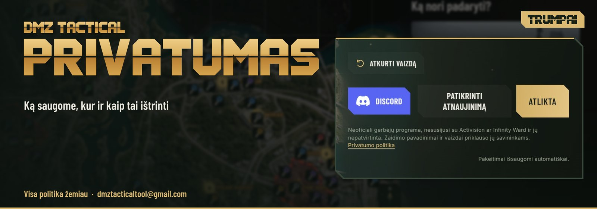

<picture>
<source media="(max-width: 600px)" srcset="media/hajin-privacy-hero-mobile-lt.jpg">

</picture>

<picture>
<source media="(max-width: 600px)" srcset="media/hajin-privacy-cards-mobile-lt.jpg">

</picture>

<a href="README.lt.md">Atsisiuntimo puslapis</a> · <a href="https://discord.gg/PzCZNqmybB">Discord</a>

## DMZ Tactical privatumo politika

Atnaujinta: 2026 m. lapkričio 6 d. · [English](PRIVACY.md)

DMZ Tactical yra nepriklausoma nemokama Call of Duty DMZ pagalbinė programa. Čia aprašyta, kokius duomenis tvarko programa ir mūsų Discord serveris, kodėl ir kaip juos ištrinti.

Kontaktas privatumo klausimais: **dmztacticaltool@gmail.com**

## Be paskyros

Žemėlapis, reido planai, daiktų sąrašai, ginklų komplektai ir nustatymai saugomi tik tavo kompiuteryje, Windows naudotojo profilyje. Jie mums nesiunčiami.

Kad patikrintų ir atsisiųstų atnaujinimus, programa jungiasi prie GitHub. GitHub mato tavo IP adresą ([GitHub privatumo pareiškimas](https://docs.github.com/site-policy/privacy-policies/github-general-privacy-statement)).

DMZ Tactical neskaito ir nekeičia žaidimo failų, atminties ar inventoriaus. Programoje nėra analitikos ir reklamos.

## Su paskyra (komandos paieška)

Paskyra neprivaloma: jos reikia tik komandos paieškai. Prisijungi per Discord, ir mes saugome:

* **Iš Discord:** Discord naudotojo ID, vardą, avatarą ir el. pašto adresą. Mūsų prisijungimo paslauga el. pašto adresą iš Discord gauna kiekvieną kartą, kai prisijungi per Discord. Jo niekam nerodome ir laiškų juo nesiunčiame.
* **Operatoriaus profilį:** Activision ID, portretą, žaidimo stilių, regioną, kalbą ir mikrofono pasirinkimą.
* **Paieškos metu:** paieškos kalbą ir 60 sekundžių įrašą, kurį programa atnaujina, kol paieškos langas atidarytas.

Kiti žaidėjai mato tavo Activision ID, žaidimo stilių ir portretą tik tada, kai abu ieškote ta pačia kalba. Kai sustabdai paiešką ar uždarai langą, per 60 sekundžių dingsti iš jų rezultatų.

Activision ID tikriname tik pagal formatą. DMZ Tactical niekada neprisijungia prie tavo Activision paskyros.

Prisijungimo duomenys saugomi tavo kompiuteryje, užšifruoti Windows (DPAPI) tik tavo Windows naudotojui.

## Discord serveris ir botas

Jei naudojiesi mūsų Discord serveriu, DMZ Tactical botas saugo:

* Activision ID, kurį įvedi komanda `/activisionid` (botas jį perduoda į tavo paskyrą);
* mainų skelbimus su Activision ID (prieš skelbiant botas įspėja, kad ID bus viešas);
* mainų pranešimų nustatymus;
* uždarytus pagalbos pokalbius su žinutėmis ir priedais privačiame archyve.

## Kur ir kodėl saugome

| Duomenys | Kur saugomi |
| --- | --- |
| Paskyros duomenys | [Supabase](https://supabase.com/privacy), Europos Sąjungoje |
| Boto duomenys | Sparked Host, Paryžiuje, Prancūzijoje |

Duomenis naudojame:

* komandos paieškai ir tavo pasirinktoms Discord funkcijoms teikti (BDAR 6 straipsnio 1 dalies b punktas);
* pagalbos pokalbiams išsaugoti ir paslaugai apsaugoti (6 straipsnio 1 dalies f punktas).

Duomenų neparduodame ir reklamai neperduodame.

## Kiek laiko saugome

| Duomenys | Kiek saugome |
| --- | --- |
| Paskyra ir profilis | Kol juos ištrini |
| Paieškos įrašai | 60 sekundžių po paskutinio atnaujinimo |
| Uždarytų pagalbos pokalbių archyvai | 12 mėnesių, paskui ištrinami |
| Boto duomenų bazės atsarginės kopijos | Kasdien pakeičiamos naujomis, saugomos paskutinės trys |

## Kaip ištrinti duomenis

* **Programoje:** atverk savo profilį ir pasirink **Ištrinti paskyrą**. Taip ištrinama paskyra, operatoriaus profilis, paieškos įrašas ir išsaugotas Activision ID.
* **Boto duomenis:** atidaryk pagalbos pokalbį komanda `/ticket` arba rašyk dmztacticaltool@gmail.com. Atsakome per 30 dienų.

## Tavo teisės

Gali prašyti:

* leisti susipažinti su savo duomenimis arba gauti jų kopiją;
* ištaisyti ar ištrinti savo duomenis.

Taip pat gali nesutikti, kad tavo duomenys būtų naudojami.

Skundą gali pateikti Valstybinei duomenų apsaugos inspekcijai ([vdai.lrv.lt](https://vdai.lrv.lt)).

## Pakeitimai

Apie politikos pakeitimus skelbiame šioje saugykloje ir Discord serveryje.
