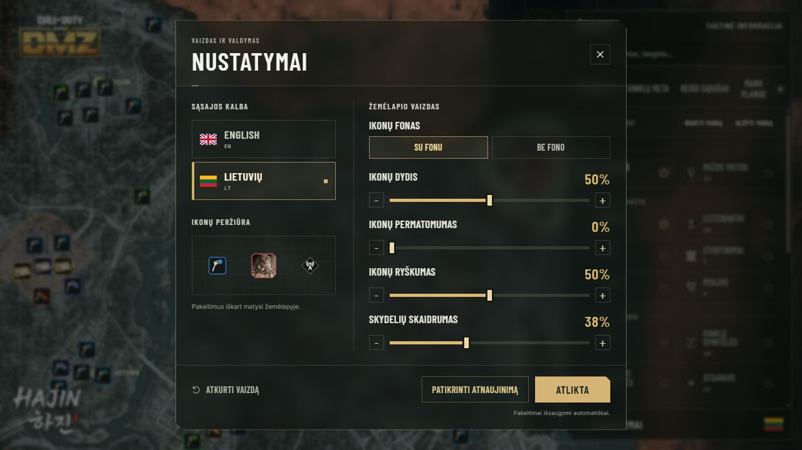

<a href="README.md">English</a> &nbsp; | &nbsp; <strong>Lietuvių</strong>

Į Hajin leiskis jau žinodamas, kur keliausi. **DMZ Tactical** sujungia žemėlapį, raktų vietas, ginklų komplektus ir reido sąrašą vienoje Windows programoje, kad kitam DMZ reidui pasiruoštum iš anksto.

Windows x64 &nbsp; · &nbsp; Lietuvių ir anglų kalbos &nbsp; · &nbsp; 1.0.5 versija

## Žinok, kur veda tavo raktas

Raktas kuprinėje turi reikšti aiškų tikslą. Atrink raktus pagal retumą, ieškok pagal pavadinimą ar žemėlapio langelį ir priartink reikiamą vietą. Keičiantis planui, persijunk į vadų, seifų, spintelių, išėjimų ar kitą kategoriją.

**Žemėlapį prisitaikyk sau.** Rodyk tik reikalingus sluoksnius, pasuk vaizdą ir pasirink savo ekranui tinkamą ikonų dydį, ryškumą bei skaidrumą. Palik ikonų fonus aiškesniam kontrastui arba išjunk juos lengvesniam vaizdui. Vadų ir leitenantų portretai išlieka tokie patys.

## Tikslus sudėk į maršrutą

Pridėk sustojimus į **Mano planą**, sudėliok jų eilę ir pažymėk vietas, kuriose jau buvai. Išsisaugok naudingas lokacijas ir susikurk savo žymas kitam reidui. Planas lieka tavo kompiuteryje, o prireikus jį gali eksportuoti ir importuoti kitame įrenginyje.

## Pasirink komplektą savo kovai

**Ginklų meta** apima pakopas nuo META iki D Tier. Palygink artimai ir tolimai kovai skirtus variantus, atverk komplektą su priedais ir išsisaugok jį arba nukopijuok priedų sąrašą. Viskas pasiekiama šalia žemėlapio, tame pačiame skydelyje.

## Žinok, ką parsinešti

Prieš išvykdamas susidėk **Reido sąrašą**. Pasirink daiktus arba 3D spausdintuvo gaminį, o reikalingos medžiagos atsidurs viename sąraše. Bendri ingredientai automatiškai susumuojami. Reido metu pažymėk, ką jau surinkai.

Rinkis iš **95 spausdintuvo receptų** ir **34 bazės patobulinimų pakopų**. Matyk, ką patobulinimas duoda, ką atrakina ir kur ieškoti medžiagų. Sąrašas lieka tavo kompiuteryje. Nereikia paskyros ar ryšio su žaidimu.

## Sukurta naudoti šalia žaidimo

Tamsi taktinė sąsaja, pažįstamos retumo spalvos ir permatomas šoninis skydelis išlaiko dėmesį žemėlapyje. Nustatymuose pasirink lietuvių arba anglų kalbą. Planuok maršrutą, tikrink raktus ir rinkis ginklo komplektą vienoje vietoje. Programa įsimena lango dydį ir padėtį kitam kartui.

## Pasiruošęs kitam reidui?

1. Viršuje esančiu mygtuku atsisiųsk **DMZTactical-Installer.exe**.
2. Patvirtink Windows administratoriaus užklausą ir pasirink diegimo vietą. Diegiklis sukurs atskirą **DMZT** aplanką bei nuorodas darbalaukyje ir meniu Pradžia.
3. Nustatymuose pasirink kalbą ir pradėk dėlioti savo planą.

**Nustatymuose** spausk **Patikrinti atnaujinimą**, šalia **Atlikta**. Išsaugotos vietos, planai ir pasirinkimai išlieka.

<strong>Prieš diegiant</strong>

- **Dabartinė versija:** 1.0.5. Nustatymų fonas priderintas prie permatomo šoninio skydelio. Abiejų skaidrumas valdomas kartu. Paskyra nereikalinga.
- **Reikalavimai:** Windows x64, administratoriaus patvirtinimas diegimui ir internetas žemėlapio vaizdui. Prireikus diegiklis atsisiunčia WebView2.
- **Naudoji 1.0 ar Preview?** Prieš paleisdamas naują diegiklį pašalink ankstesnę vienam vartotojui skirtą versiją per Windows nustatymus. Išsaugoti planai ir pasirinkimai išliks.
- **Windows pranešimas:** diegiklis neturi kodo pasirašymo sertifikato. Windows gali rodyti nežinomą leidėją arba SmartScreen įspėjimą.
- **Žemėlapio duomenys:** vietų katalogas įtrauktas į programą. Katalogas atnaujinamas kartu su programos versijomis. Atsiradimo vietos ir bendruomenės rekomenduojami ginklų komplektai gali keistis kartu su žaidimu.
- **Atsisiuntimas:** diegimui reikia tik **DMZTactical-Installer.exe**. NUPKG failas skirtas atnaujinimams pačioje programoje. GitHub Source code archyvuose yra šio atsisiuntimo puslapio failai, ne diegiklis.

[Versijos informacija](https://github.com/DMZTactical/DMZT/releases/tag/v1.0.5)

Nepriklausomas bendruomenės įrankis, nesusijęs su Activision ar Infinity Ward ir jų nepatvirtintas. Žaidimo pavadinimai, žemėlapio vaizdai ir žaidimo grafika priklauso jų savininkams.
