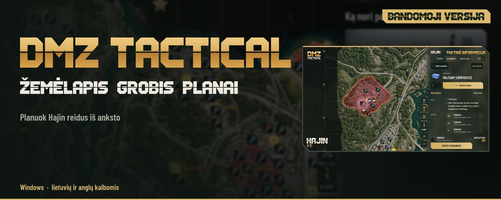

<p align="center">
<picture>
<source media="(max-width: 600px)" srcset="media/hajin-r6-hero-mobile-lt.jpg">

</picture>
</p>

<p align="center"><a href="README.md">English</a> · <strong>Lietuvių</strong> · <a href="https://dmzt.app/lt/">Svetainė</a></p>

<p align="center">
<a href="https://github.com/DMZTactical/DMZT/releases/download/v0.9.37-beta.1/DMZTactical-Installer.exe"></a>
<a href="https://discord.gg/PzCZNqmybB"></a>
<br>
<a href="https://github.com/DMZTactical/DMZT/releases/tag/v0.9.37-beta.1"></a>
<a href="#duk"></a>
</p>

# DMZ Tactical – Hajin žemėlapis, daiktų paieška ir reido planas MW4 DMZ

**DMZ Tactical** – nemokama pagalbinė Windows programa **Call of Duty: Modern Warfare 4 DMZ** žaidėjams. **Hajin** ir **X01** žemėlapyje rasi kiekvieną raktą, vietovę ir langelį, matysi, kur iškrenta daiktai, susiplanuosi reidą ir atversi jį žaidime paspaudęs **F8**. Žemėlapis veikia be interneto, paskyros nereikia.

<p align="center"></p>

## Galimybės

### Hajin ir X01 žemėlapis su visais raktais
- Raktai, užrakintos durys ir svarbūs objektai pagal retumą
- Vietovės, išvykimo taškai, vadai ir langeliai (pvz., B5 ar F4)
- Pavojaus zonos rodo tikėtinas kautynes su žaidėjais
- UAV režimas rodo orbitinę žemėlapio peržiūrą
- Veikia be interneto

### Rask bet kurį daiktą ir kur jis iškrenta
- Ieškok daikto, rakto ar vietovės
- Konteineriai su dažniu, pvz., Tool Chest 1 iš 52
- Daiktus įsidėk į „Ką surinkti“ sąrašą su reikiamu kiekiu
- FOB patobulinimai ir 3D spausdintuvo daiktai pridėda medžiagas patys

<p align="center"></p>

### Reido planas ir langas virš žaidimo
- Užduotys, sustojimai, raktai ir ginkluotė viename reido plane
- DMZ Orders pažanga ir „Ką surinkti“ sąrašas, rodantis, ko dar trūksta
- Žaidime paspaudęs F8 virš Call of Duty matysi maršrutą, daiktų sąrašą ir žemėlapį
- Paieškos zonos mažame žemėlapyje. Tavo vietos jis nerodo
- Veikia Borderless arba Windowed režimu

<p align="center"></p>

### Ginklų meta, komplektai ir Operator Traits
- Season 1 ginklų lygiai nuo Meta iki D
- Tolimo nuotolio ir universalūs komplektai su priedų atrakinimo lygiais
- Operator Traits planavimas su taškais ir kompromisais

## Nuo ko pradėti

1. **Įdiek.** Atsisiųsk [DMZTactical-Installer.exe](https://github.com/DMZTactical/DMZT/releases/download/v0.9.37-beta.1/DMZTactical-Installer.exe) ir paleisk.
2. **Surask.** Ieškok rakto, daikto, vietovės ar langelio.
3. **Spausk F8.** Žaidime nustatyk Borderless arba Windowed režimą ir reido metu paspausk F8.

**Jau naudoji bandomąją versiją?** Atverk Nustatymus ir pasirink **Tikrinti atnaujinimus**. Jei atnaujinimas nepasirodo, atsisiųsk diegimo failą ir paleisk jį. Planai ir nustatymai išlieka.

**Žemėlapis neįsikelia?** Įdiek [Microsoft Edge WebView2](https://developer.microsoft.com/microsoft-edge/webview2/#download) ir paleisk programą iš naujo.

### Reikalavimai
- Windows 10 arba 11, 64 bitų, ir administratoriaus teisės diegimui
- Microsoft Edge WebView2
- Interneto ryšys atsisiuntimui ir atnaujinimams
- Langui virš žaidimo – Borderless arba Windowed režimas

## Kas toliau

<picture>
<source media="(max-width: 600px)" srcset="media/hajin-roadmap-1-0-r6-mobile-lt.jpg">

</picture>

<p align="center">Naujienos – <a href="https://discord.gg/PzCZNqmybB">Discord serveryje</a>.</p>

## Patikrink atsisiųstą failą

Atverk Terminal aplanke su diegimo failu ir paleisk:

```powershell
Get-FileHash .\DMZTactical-Installer.exe | Format-List
```

Suma turi būti `C906B4E5C9FFBD85282723BB48103EB34F4245C77CA17FEB8766FB05B4DC480B`.
[SHA256SUMS.txt](https://github.com/DMZTactical/DMZT/releases/download/v0.9.37-beta.1/SHA256SUMS.txt) · [VirusTotal ataskaita](https://www.virustotal.com/gui/file/c906b4e5c9ffbd85282723bb48103eb34f4245c77ca17feb8766fb05b4dc480b)

Diegimo failas dar neturi skaitmeninio parašo, todėl Windows SmartScreen ar kai kurios antivirusinės programos gali įspėti. Atnaujinimai tikrinami pagal pasirašytą sąrašą ir kontrolines sumas.

## DUK

**Ar DMZ Tactical nemokama?**
Taip. Ją galima atsisiųsti ir naudoti nemokamai. Nėra reklamų ir mokamų funkcijų.

**Ar saugu naudoti su Call of Duty?**
DMZ Tactical veikia kaip atskira Windows programa. Ji neskaito ir nekeičia žaidimo failų ar atminties ir nesiunčia žaidimui komandų. F8 langas yra įprastas Windows langas virš žaidimo. Activision DMZ Tactical neperžiūrėjo, todėl negalime pasakyti, kaip jų apsaugos sistemos vertina kitas programas.

**Kokie žemėlapiai yra programoje?**
Hajin ir X01 Exclusion Zone su abiem X01 Black Site aukštų planais.

**Ar programa tinka PlayStation ir Xbox žaidėjams?**
Taip, Windows kompiuteryje šalia konsolės. Langui virš žaidimo reikia žaidimo tame pačiame kompiuteryje.

**Ar programa mato mano inventorių?**
Ne. Kiekius įvedi pats.

**Ar bus Mac versija?**
Dar ne. Mac versiją kuriame dabar (roadmap'o 0.9.4), o 1.0 veiks Windows ir Mac.

**Kokios kalbos palaikomos?**
Lietuvių ir anglų. Žemėlapių, daiktų ir vietovių pavadinimai rodomi taip, kaip žaidime.

Daugiau atsakymų – [svetainėje](https://dmzt.app/lt/#faq).

---

<sub>© 2026 DMZ Tactical. Gerbėjų sukurta pagalbinė programa, nesusijusi, nepatvirtinta ir neremiama Activision Publishing, Inc. ar Infinity Ward. Call of Duty® ir susiję ženklai yra Activision Publishing, Inc. prekių ženklai. Visas žaidimo turinys ir vaizdai priklauso jų savininkams. · [Privatumo politika](PRIVACY.lt.md) · [Licencijos sąlygos](LICENSE.md)</sub>
