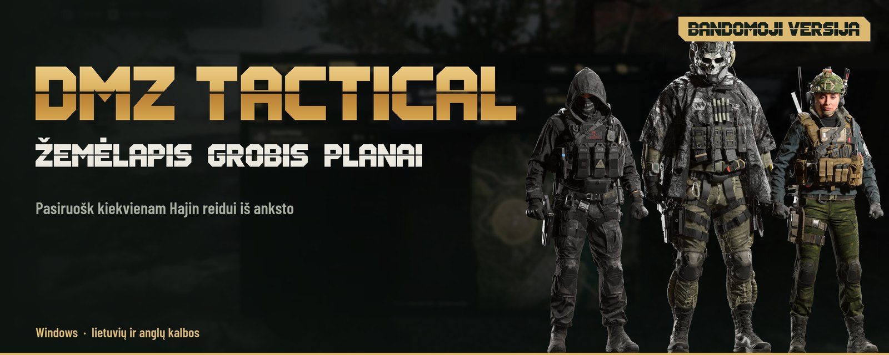
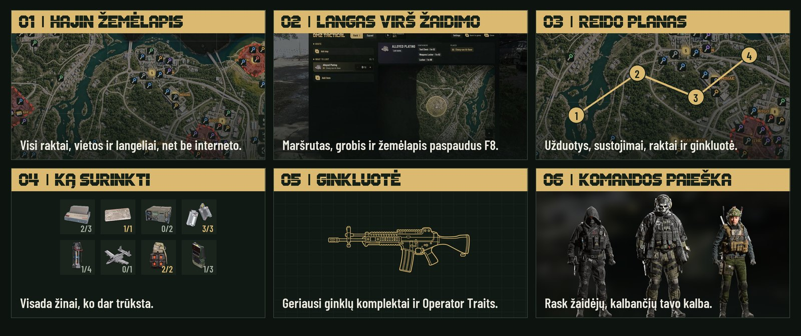
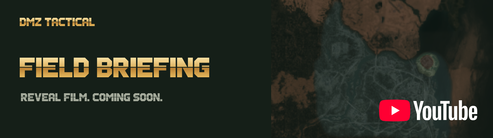
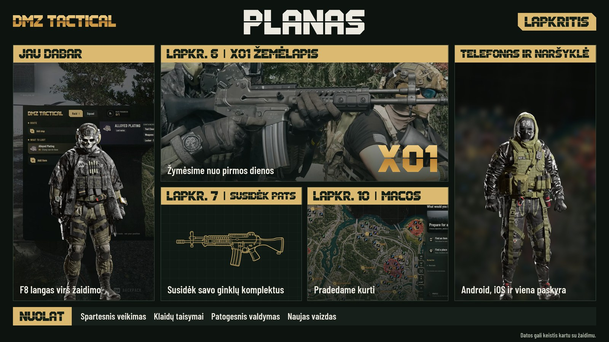
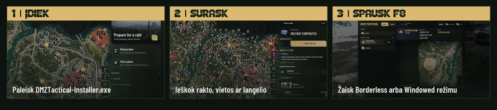

<picture>
<source media="(max-width: 600px)" srcset="media/hajin-r3-hero-mobile-lt.jpg">

</picture>

<a href="README.md">English</a> · <strong>Lietuvių</strong>

 

 

## Viskas tavo reidui

Pasiruošk reidui **Hajin** žemėlapyje, o žaidime spausk **F8**. Veikia **be interneto** ir be paskyros.

<picture>
<source media="(max-width: 600px)" srcset="media/hajin-r3-features-mobile-lt.jpg">

</picture>

## Kas toliau

<picture>
<source media="(max-width: 600px)" srcset="media/hajin-r3-roadmap-mobile-lt.jpg">

</picture>

Naujienos – <a href="https://discord.gg/PzCZNqmybB">Discord serveryje</a>.

## Nuo ko pradėti

<picture>
<source media="(max-width: 600px)" srcset="media/hajin-r3-steps-mobile-lt.jpg">

</picture>

<strong>Jau naudoji bandomąją versiją?</strong> Nustatymai → <strong>Patikrinti atnaujinimą</strong>.

## DUK

<picture>
<source media="(max-width: 600px)" srcset="media/hajin-r3-faq-mobile-lt.jpg">

</picture>

<picture>
<source media="(max-width: 600px)" srcset="media/hajin-r3-details-mobile-lt.jpg">

</picture>

Nepriklausomas bendruomenės įrankis. Nesusijęs su Activision ar Infinity Ward ir nėra jų patvirtintas. Žaidimų pavadinimai, žemėlapio vaizdai ir žaidimo grafika priklauso jų savininkams.
