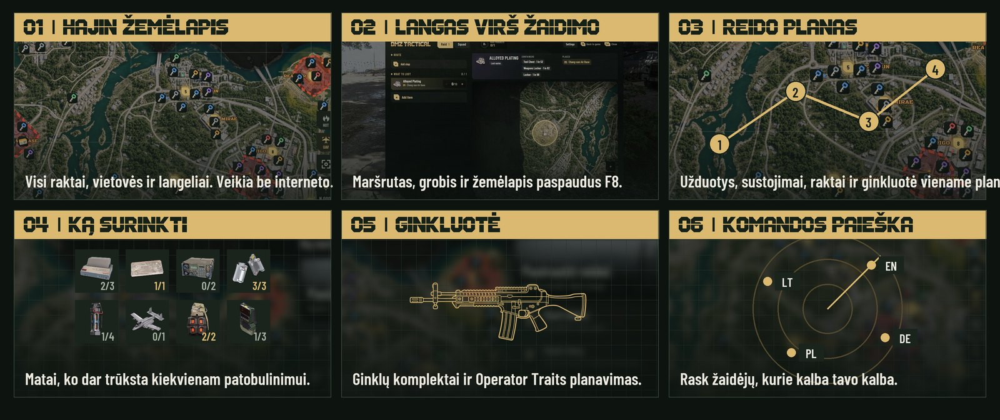
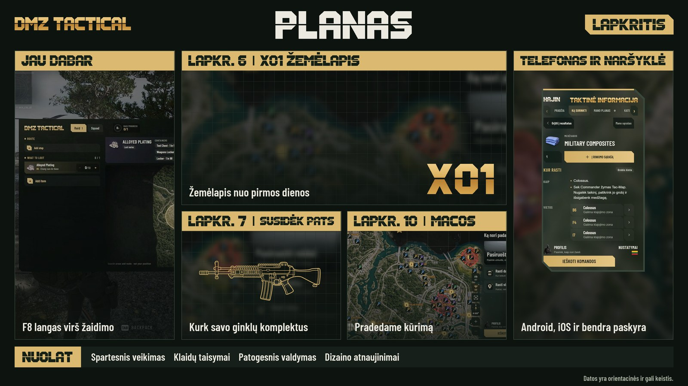
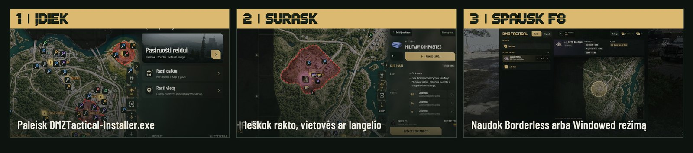
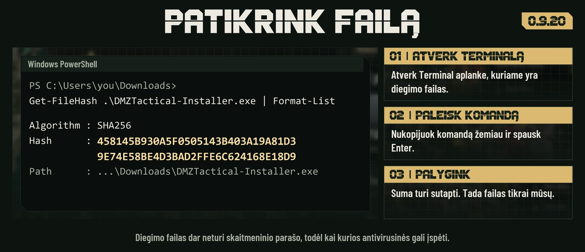

<p align="center">
<picture>
<source media="(max-width: 600px)" srcset="media/hajin-r6-hero-mobile-lt.jpg">

</picture>
</p>

<p align="center"><a href="README.md">English</a> · <strong>Lietuvių</strong></p>

<p align="center">
<a href="https://github.com/DMZTactical/DMZT/releases/download/v0.9.20-beta.1/DMZTactical-Installer.exe"></a>
<a href="https://discord.gg/PzCZNqmybB"></a>
<br>
<a href="https://github.com/DMZTactical/DMZT/releases/tag/v0.9.20-beta.1"></a>
<a href="https://developer.microsoft.com/microsoft-edge/webview2/#download"></a>
<br>
<a href="#duk"></a>
</p>

## Viskas reidui vienoje vietoje

Planuok reidą **Hajin** žemėlapyje, o žaidime atsidaryk jį paspaudęs **F8**. Veikia be interneto ir be paskyros.

<picture>
<source media="(max-width: 600px)" srcset="media/hajin-r6-features-mobile-lt.jpg">

</picture>


## Kas toliau

<picture>
<source media="(max-width: 600px)" srcset="media/hajin-r6-roadmap-mobile-lt.jpg">

</picture>

<p align="center">Naujienos – <a href="https://discord.gg/PzCZNqmybB">Discord serveryje</a>.</p>

## Nuo ko pradėti

<picture>
<source media="(max-width: 600px)" srcset="media/hajin-r6-steps-mobile-lt.jpg">

</picture>

<p align="center"><strong>Jau naudoji bandomąją versiją?</strong> Atverk Nustatymus ir spausk <strong>Patikrinti atnaujinimą</strong>. Jei atnaujinimas nepasirodo, atsisiųsk diegimo failą ir paleisk jį. Tavo planai ir nustatymai išliks.</p>

<p align="center"><a href="https://developer.microsoft.com/microsoft-edge/webview2/#download"></a></p>

## Patikrink atsisiųstą failą

<picture>
<source media="(max-width: 600px)" srcset="media/hajin-verify-0-9-20-mobile-lt.jpg">

</picture>

```powershell
Get-FileHash .\DMZTactical-Installer.exe | Format-List
```

<p align="center">Suma: <code>458145B930A5F0505143B403A19A81D39E74E58BE4D3BAD2FFE6C624168E18D9</code><br><a href="https://github.com/DMZTactical/DMZT/releases/download/v0.9.20-beta.1/SHA256SUMS.txt">SHA256SUMS.txt</a> · <a href="https://www.virustotal.com/gui/file/458145b930a5f0505143b403a19a81d39e74e58be4d3bad2ffe6c624168e18d9">VirusTotal ataskaita</a></p>

## DUK

<picture>
<source media="(max-width: 600px)" srcset="media/hajin-r6-faq-mobile-lt.jpg">

</picture>

<picture>
<source media="(max-width: 600px)" srcset="media/hajin-r6-details-mobile-lt.jpg">

</picture>

<p align="center"><sub>© 2026 DMZ Tactical. Gerbėjų sukurta pagalbinė programa, nesusijusi su Activision Publishing, Inc. ar Infinity Ward, jų nepatvirtinta ir neremiama.<br>Call of Duty® ir susiję ženklai yra Activision Publishing, Inc. prekių ženklai. Visas žaidimo turinys ir vaizdai priklauso jų savininkams.<br><a href="PRIVACY.lt.md">Privatumo politika</a> · <a href="LICENSE.md">Licencijos sąlygos</a></sub></p>
