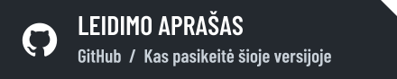
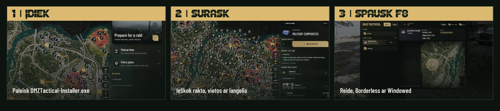
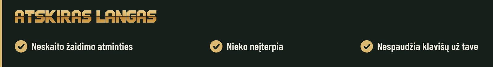

<picture>
<source media="(max-width: 600px)" srcset="media/hajin-hero-mobile-lt.jpg">

</picture>

<a href="README.md">English</a> · <strong>Lietuvių</strong>

 

## Viskas tavo reidui

Planuok **Hajin** žemėlapyje. Reide spausk **F8**. Veikia **be interneto ir be paskyros**.

<picture>
<source media="(max-width: 600px)" srcset="media/hajin-features-mobile-lt.jpg">

</picture>

## Kas toliau

<picture>
<source media="(max-width: 600px)" srcset="media/hajin-roadmap-mobile-lt.jpg">

</picture>

Naujienos – <a href="https://discord.gg/PzCZNqmybB">Discord serveryje</a>.

## Nuo ko pradėti

<picture>
<source media="(max-width: 600px)" srcset="media/hajin-steps-mobile-lt.jpg">

</picture>

<strong>Jau turi beta versiją?</strong> Nustatymai → <strong>Patikrinti atnaujinimą</strong>.

## DUK

<picture>
<source media="(max-width: 600px)" srcset="media/hajin-facts-mobile-lt.jpg">

</picture>

<strong>Ar gali užblokuoti paskyrą?</strong>

DMZ Tactical žaidimo neliečia. Programa neskaito žaidimo atminties, nieko į jį neįterpia ir nespaudžia klavišų už tave. Overlay yra atskiras langas virš žaidimo, o F8 – įprastas Windows spartusis klavišas. Ką leidžia, sprendžia tik Activision, bet programa su žaidimo procesu nesusijusi.

<strong>Ar tai nemokama?</strong>

Taip. Atsisiųsk šio puslapio viršuje.

<strong>Ar veikia su PlayStation ar Xbox?</strong>

Programa veikia Windows. Žemėlapis, rinkimo sąrašas ir reido planai veikia kompiuteryje šalia konsolės. F8 overlay reikia, kad žaidimas veiktų tame pačiame kompiuteryje.

<strong>Ar programa skaito mano inventorių ar seka kitus žaidėjus?</strong>

Ne. Kiekius žymi pats. Hot Zones yra numanoma rizika, ne gyvos pozicijos.

<strong>Windows rodo „Unknown Publisher“. Ar saugu?</strong>

Diegiklis kol kas neturi kodo parašo, todėl Windows rodo šį pranešimą. Atnaujinimai programoje tikrinami pagal pasirašytą manifestą ir failų kontrolines sumas.

<strong>Ar bus Mac versija?</strong>

macOS programėlę pradedame kurti lapkričio 10 d. Telefonai ir svetainė – vėliau.

<strong>Kas viduje</strong>

- **Hajin žemėlapis:** vietos, raktai, vadai ir svarbūs objektai. Veikia be interneto.
- **Hot Zones:** numanoma PvP rizika. Žaidėjų neseka.
- **Reido planai:** sustojimai ir DMZ Orders pažanga. Reido langą gali prisegti antrame monitoriuje.
- **Rinkimo sąrašai:** daiktai, receptai ir patobulinimai, kiekiai išsaugomi tarp reidų.
- **Weapon Meta ir Operator Traits:** komplektai ir bruožų planas pagal tavo taškus.

<strong>Komandos paieška ir privatumas</strong>

- Prisijunk per Discord, įrašyk Activision ID ir ieškok žaidėjų savo kalba.
- Ieškančius mato tik tie, kurie patys ieško. Sustabdžius paiešką, iš sąrašo dingsti per 60 sekundžių.
- Tikrinamas ID formatas, bet ne paskyros nuosavybė.
- Žaidimas, jo procesas ir tavo inventorius niekada neskaitomi.

<strong>Reikalavimai</strong>

- Windows x64, administratoriaus patvirtinimas diegimui, Microsoft Edge WebView2.
- Interneto reikia atsisiuntimams, komandos paieškai ir atnaujinimams. Žemėlapis ir planai veikia be jo.
- Exclusive fullscreen paslepia overlay. Naudok Borderless arba Windowed.
- Diegiklis neturi Authenticode parašo, todėl Windows gali rodyti *nežinomą leidėją*. Atnaujinimai tikrinami pagal pasirašytą manifestą.
- Užtenka **DMZTactical-Installer.exe**. NUPKG failai skirti atnaujinimams programoje.

Nepriklausomas bendruomenės įrankis. Nesusijęs su Activision ar Infinity Ward ir nėra jų patvirtintas. Žaidimų pavadinimai, žemėlapio vaizdai ir žaidimo grafika priklauso jų savininkams.
