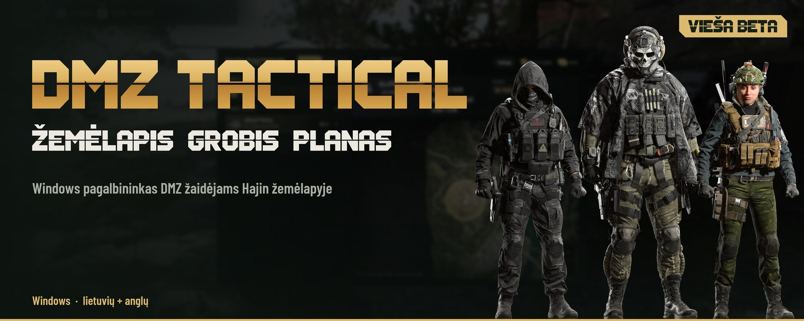
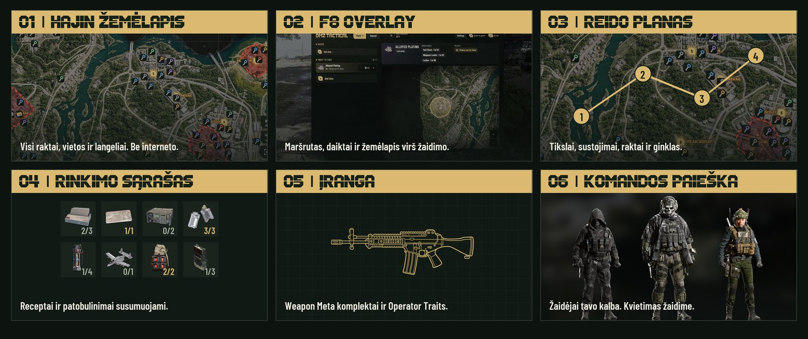
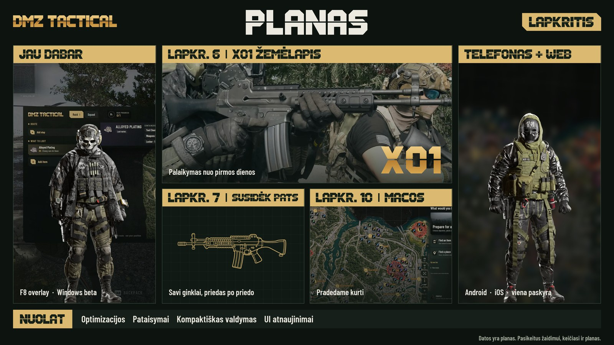

<picture>
<source media="(max-width: 600px)" srcset="media/hajin-hero-mobile-lt.jpg">

</picture>

<a href="README.md">English</a> · <strong>Lietuvių</strong>

 

## Viskas tavo reidui

Planuok **Hajin** žemėlapyje. Reide spausk **F8**. Veikia **be interneto ir be paskyros**.

<picture>
<source media="(max-width: 600px)" srcset="media/hajin-features-mobile-lt.jpg">

</picture>

## Kas toliau

<picture>
<source media="(max-width: 600px)" srcset="media/hajin-roadmap-mobile-lt.jpg">

</picture>

Naujienos – <a href="https://discord.gg/PzCZNqmybB">Discord serveryje</a>.

## Nuo ko pradėti

1. Atsisiųsk **DMZTactical-Installer.exe**, uždaryk veikiančią programą ir atlik Windows diegimo žingsnius.
2. **Nustatymuose** pasirink lietuvių arba anglų kalbą. Ieškok rakto, vietovės ar žemėlapio langelio.
3. Pasiruošk planą. Reido metu spausk **F8**, kai žaidimas veikia **Borderless** arba **Windowed** režimu.

**Jau turi beta versiją?** Atverk **Nustatymus** ir spausk **Patikrinti atnaujinimą**.

Jei programa atsidaro, bet žemėlapis lieka tuščias, Windows trūksta Microsoft WebView2.

<strong>Žemėlapis, daiktai ir įranga</strong>

Į programą įtrauktame **Hajin žemėlapyje** ieškok vietų, raktų, vadų ir svarbių objektų. Pridėk sustojimus prie išsaugoto plano; **DMZ Orders** saugo užduočių žingsnius ir dalinę pažangą. Reido langą galima prisegti antrame monitoriuje, o pakeitimai grįžta į pagrindinį planą.

**Ką surinkti** sujungia daiktus, receptus ir bazės patobulinimus. Bendros medžiagos susumuojamos, kiekiai išsaugomi tarp reidų. Daiktų aprašuose yra gavimo patarimų, vietų nuorodų ir turimų pavyzdinių nuotraukų. Tavo inventorius žaidime niekada neskaitomas.

**Weapon Meta** pateikia ginklų reitingus ir priedų rekomendacijas. **Operator Traits** apima Warfighter, Scout ir Survivalist medžius: planuok pagal uždirbtus taškus, o Minor pavyzdžius laikyk atskirai nuo iš tikrųjų gautų bruožų. Rekomendacijos gali keistis atnaujinus žaidimą.

**Hot Zones** rodo numanomą PvP riziką, bet neseka žaidėjų ar aktyvių išėjimų. **UAV** yra pasirenkama kameros orbita aplink žemėlapio žymą. Abu režimus galima išjungti.

<strong>Komandos paieška ir privatumas</strong>

Prisijunk per **Discord**, įrašyk **Activision ID** ir ieškok žaidėjų savo kalba. Peržiūrėk operatorių, šaukinį ir žaidimo stilių, nukopijuok ID ir pakviesk žaidime. ID galima įrašyti ir Discord serveryje komanda `/activisionid`.

Kitus ieškančiuosius mato tik tie, kurie patys ieško. Sustabdžius paiešką, uždarius langą ar pakeitus kalbą, iš sąrašo dingsti per **60 sekundžių**. Tikrinamas ID formatas, bet ne Activision paskyros nuosavybė.

DMZ Tactical neskaito žaidimo proceso, neseka gyvų žaidėjų pozicijų ir nekeičia bruožų žaidime.

<strong>Windows reikalavimai ir diegimo pagalba</strong>

- **Windows x64** ir administratoriaus patvirtinimas diegimui.
- **Microsoft Edge WebView2**. Jei jo trūksta, diegiklis bando jį įdiegti. Jeigu programa atsidaro, bet žemėlapis tuščias, [įdiek WebView2](https://developer.microsoft.com/microsoft-edge/webview2/#download).
- Interneto reikia atsisiuntimams, komandos paieškai ir atnaujinimams. Žemėlapis, rinkimo sąrašai ir reido planavimas veikia be interneto.
- Išskirtinis viso ekrano režimas gali uždengti overlay ar prisegtą langą. Naudok Borderless, Windowed arba antrą monitorių.
- Diegiklis neturi Authenticode parašo, todėl Windows gali rodyti **nežinomo leidėjo** pranešimą. Programos atnaujinimai tikrinami pagal pasirašytą manifestą ir failų kontrolines sumas.
- Naujam diegimui užtenka **DMZTactical-Installer.exe**. NUPKG failai skirti atnaujinimams programoje. GitHub **Source code** archyvuose yra šis atsisiuntimo puslapis, o ne privatus programos kodas.

Nepriklausomas bendruomenės įrankis. Nesusijęs su Activision ar Infinity Ward ir nėra jų patvirtintas. Žaidimų pavadinimai, žemėlapio vaizdai ir žaidimo grafika priklauso jų savininkams.
