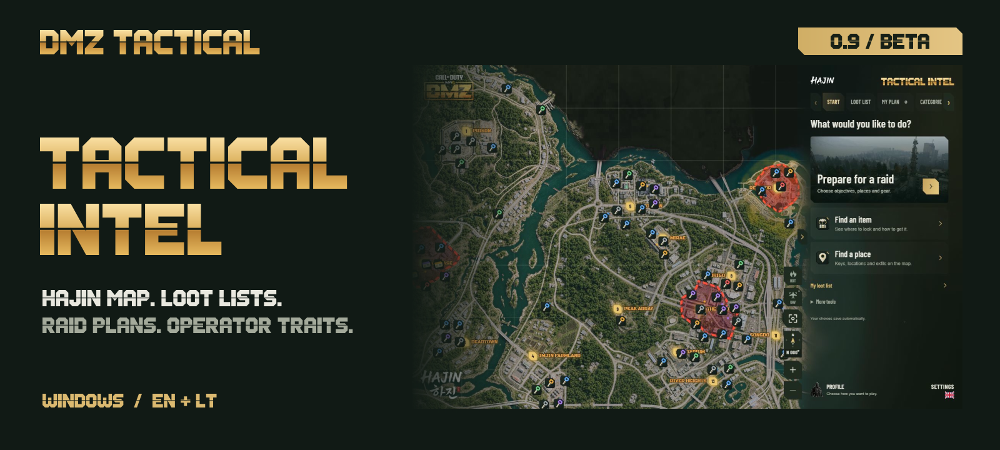
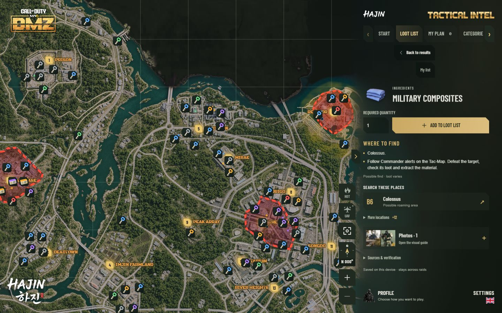
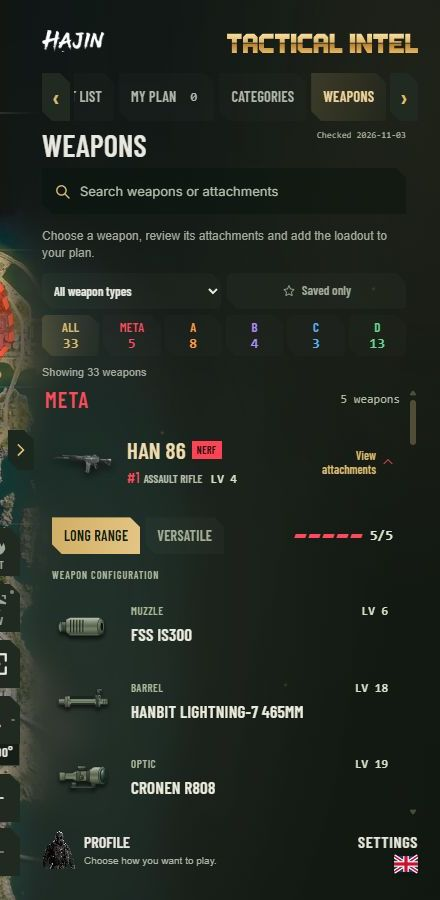
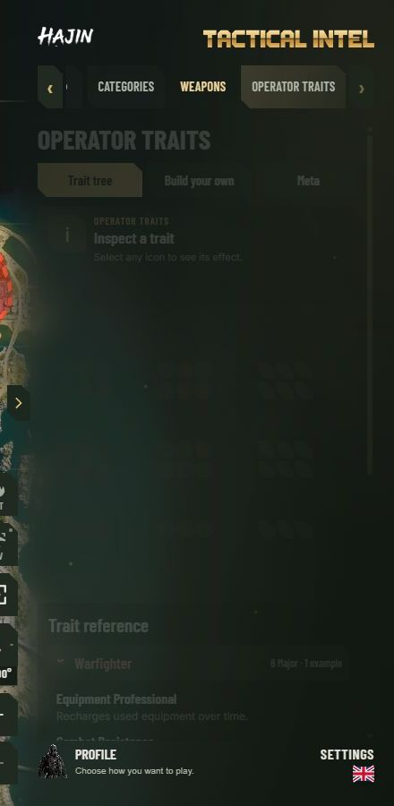

<a href="README.md">English</a> &nbsp; · &nbsp; <strong>Lietuvių</strong>

**DMZ Tactical yra Windows programėlė Hajin reidams.** Susidėk maršrutą pagal tai, ko ieškai, turėk užduočių žingsnius po ranka ir pradėk kitą reidą su paruoštu planu.

## Hajin iš arčiau

Ieškok rakto, vietovės ar žemėlapio langelio. Įjunk reikiamus sluoksnius, peržiūrėk vadus ir svarbias vietas, pažymėk būsimus sustojimus. Visas žemėlapis įtrauktas į programėlę ir veikia be interneto.

**Hot Zones** rodo numanomas PvP zonas ir trumpai paaiškina riziką. **UAV** leidžia apžiūrėti pasirinktą žymą besisukančia kamera. Abu režimus galima išjungti. Hot Zones neseka žaidėjų ir aktyvių išėjimų.

## Kiekvienas sustojimas turi tikslą

Skiltyje **Mano planas** prieš reidą sudėk užduotis, vietas, raktus ir ginklo komplektą. Pradėjus reidą pirmiausia rodomi likę tikslai ir sustojimai. Išsaugok skirtingus pasiruošimus ir grįžk prie nebaigto reido nekartodamas darbo.

**DMZ Orders** saugo užduočių žingsnius ir dalinę pažangą. Atskiras **reido langas** leidžia laikyti sąrašą šalia žaidimo arba kitame monitoriuje. Pažangą žymi pats; pakeitimai iškart atsispindi pagrindiniame plane.

## Rask ir parsinešk

Į **Ką surinkti** sąrašą pridėk daiktų, gamybos receptų ir bazės patobulinimų. Bendros medžiagos susumuojamos, todėl matai, kiek reikia, kiek jau turi ir kiek dar trūksta.

Atvėręs daiktą rasi gavimo patarimus, vietų nuorodas ir turimas pavyzdines nuotraukas. Kiekiai išsaugomi tarp reidų. Žaidimo inventorius automatiškai neskaitomas.

## Įranga ir operatoriaus planas

**Ginklų meta** vienoje vietoje pateikia ginklų reitingus, turimus priedų komplektus ir išsaugotus pasirinkimus. Peržiūrėk komplektą ir pridėk jį prie plano. Bendruomenės rekomendacijos gali keistis atnaujinus žaidimą.

**Operator Traits** apima Warfighter, Scout ir Survivalist medžius. Susipažink su bruožais, planuok pagal uždirbtus taškus ir išsaugok rinkinį. Minor pavyzdžiai bei nepatvirtintos rezervacijos atskirti nuo bruožų, kuriuos iš tikrųjų gavai.

<table>
<tr><td width="50%"></td><td width="50%"></td></tr>
<tr><td align="center">Ginklų meta</td><td align="center">Operator Traits</td></tr>
</table>

## Pamatyk, kaip veikia

## Įsidiek beta versiją

Atsisiųsk **DMZTactical-Installer.exe**, uždaryk veikiančią DMZ Tactical ir atlik Windows diegimo žingsnius. Kalbą pasirink Nustatymuose. Žemėlapis, rinkimo sąrašas ir reido planavimas veikia be paskyros.

**Jau turi 0.9.0-beta.1?** Atverk Nustatymus ir spausk **Patikrinti atnaujinimą**.

**Jau naudoji 1.x kūrimo versiją?** Šis leidimas pradeda naują viešą numeravimo seką. Eksportuok planus atsarginei kopijai, pašalink seną programos versiją per Windows nustatymus ir įdiek 0.9.1-beta.1. Palik esamą programos duomenų aplanką, kad išliktų planai ir pasirinkimai. Senasis atnaujinimas mažesnio numerio versijos neįdiegs.

<strong>Reikalavimai ir beta informacija</strong>

Diegimui reikia Windows x64 ir administratoriaus patvirtinimo. Būtinas veikiantis Microsoft Edge WebView2. Jei jo trūksta, diegimo programa bando jį įdiegti; be šio komponento programėlė neatsidarys. Interneto reikia atsisiuntimams, paskyros funkcijoms ir atnaujinimams. Diegiklis neturi Authenticode parašo, todėl Windows gali rodyti nežinomo leidėjo pranešimą.

Tai išankstinis leidimas. Ginklų redaktorius **Susidėk pats** laikinai paslėptas; anksčiau išsaugoti komplektai palikti. **Komandos paieška** veikia prisijungus per Discord ir įrašius Activision ID. Kitus ieškančiuosius mato tik patys ieškantys žaidėjai. Tikrinamas ID formatas, bet ne paskyros nuosavybė.

Reido langui naudok kitą monitorių arba žaidimą lange ar be rėmelių. Išskirtinis viso ekrano režimas gali jį uždengti. Naudodamas šį langą palik DMZ Tactical veikti.

Programėlė skirta planavimui. Ji neskaito žaidimo proceso, neseka gyvų žaidėjų pozicijų ir nekeičia bruožų žaidime. Žemėlapio pastabos bei bendruomenės patarimai gali keistis kartu su žaidimu.

Naujam diegimui užtenka **DMZTactical-Installer.exe**. NUPKG failas skirtas programos atnaujinimams. GitHub automatiškai sukurti Source code archyvai apima šį viešą atsisiuntimo puslapį ir jo vaizdus; programos pirminis kodas laikomas atskiroje privačioje saugykloje.

Nepriklausomas bendruomenės įrankis. Nesusijęs su Activision ar Infinity Ward ir nėra jų patvirtintas. Žaidimo pavadinimai, žemėlapio vaizdai ir žaidimo iliustracijos priklauso jų savininkams.
