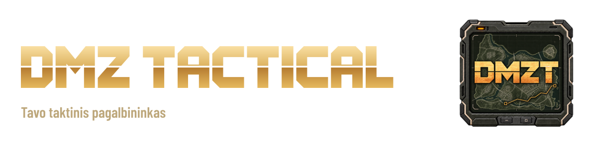
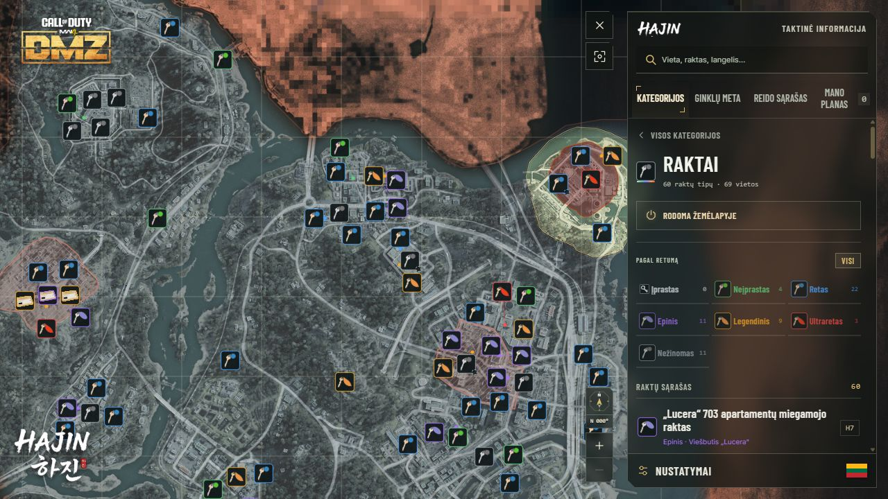
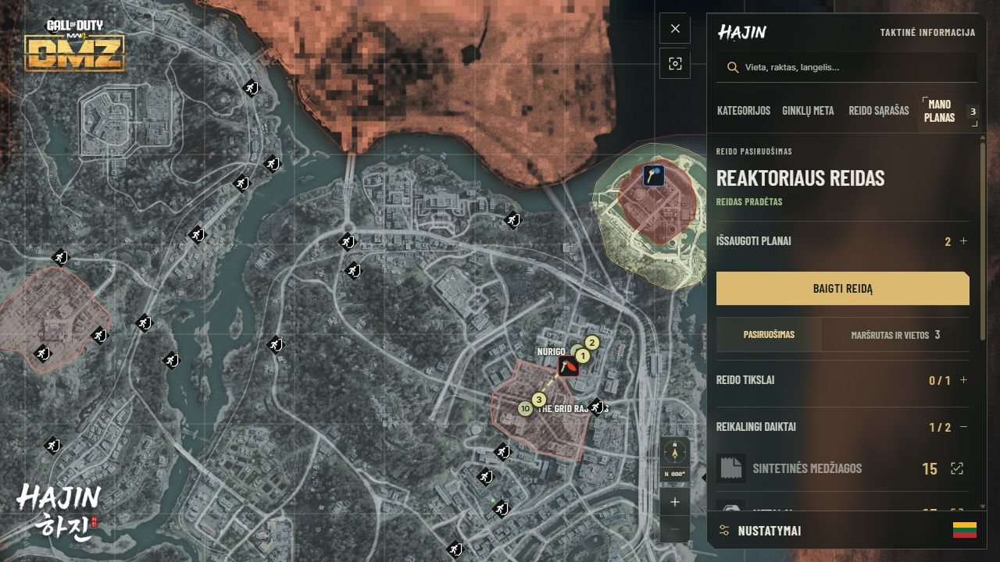
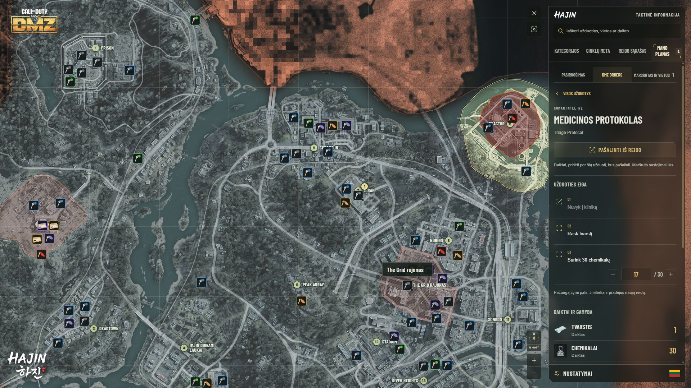
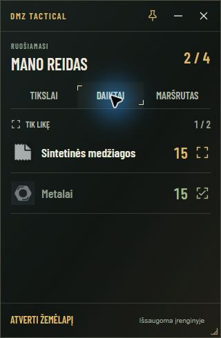
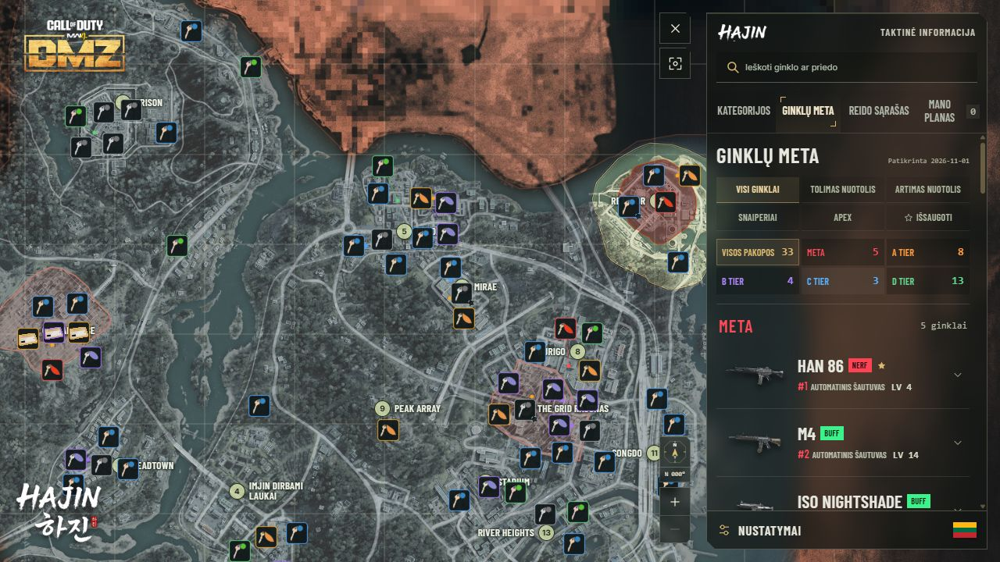
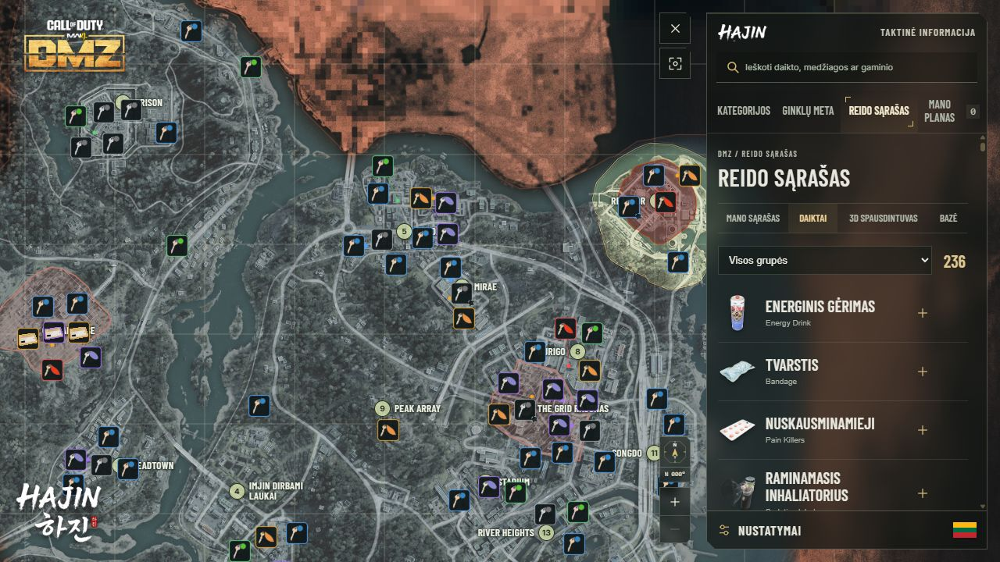
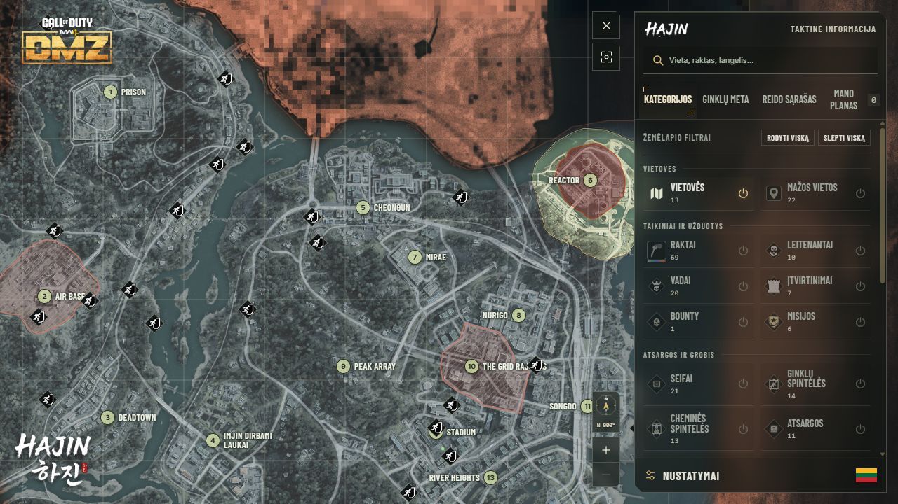
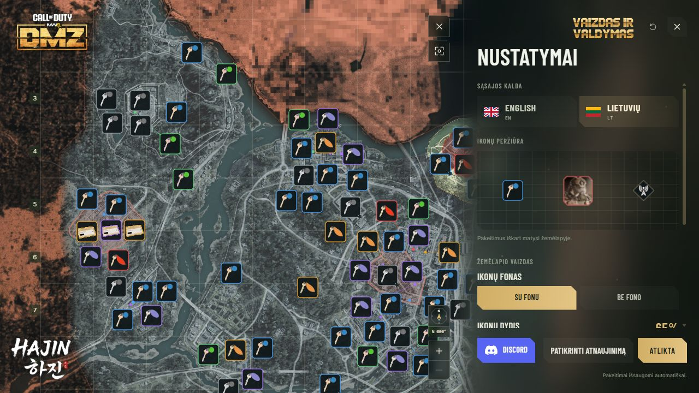

<a href="README.md">English</a> &nbsp; | &nbsp; <strong>Lietuvių</strong>

Į Hajin leiskis jau žinodamas, kur keliausi. **DMZ Tactical** sujungia žemėlapį, raktų vietas, ginklų komplektus ir tęstinį rinkimo sąrašą vienoje Windows programoje, kad kitam DMZ reidui pasiruoštum iš anksto.

 &nbsp; 

Windows x64 &nbsp; · &nbsp; Lietuvių ir anglų kalbos &nbsp; · &nbsp; 1.4.47 versija

## Žinok, kur veda tavo raktas

Raktas kuprinėje turi reikšti aiškų tikslą. Atrink raktus pagal retumą, ieškok pagal pavadinimą ar žemėlapio langelį ir priartink reikiamą vietą. Keičiantis planui, persijunk į vadų, seifų, spintelių, išėjimų ar kitą kategoriją.

**Žemėlapį prisitaikyk sau.** Rodyk tik reikalingus sluoksnius, pasuk vaizdą ir pasirink savo ekranui tinkamą ikonų dydį, ryškumą bei skaidrumą. Palik ikonų fonus aiškesniam kontrastui arba išjunk juos lengvesniam vaizdui. Vadų ir leitenantų portretai išlieka tokie patys.

## Pasiruošk iš anksto. Reide susitelk į tikslą.

Skiltyje **Mano planas** susidėk tikslus, pasiimamus raktus, maršrutą ir ginklo komplektą. Išsaugok atskirus pasiruošimus medžiagų rinkimui, užrakintoms vietoms ar vadų medžioklei.

Pradėjus reidą, žemėlapyje lieka tavo sustojimai, raktų vietos ir pasirinktinai galimi išėjimai. Žymėk įvykdytus tikslus, surinktus daiktus ir aplankytas vietas. Vėl atidaręs programą tęsk nebaigtą reidą arba pradėk kitą su tuo pačiu pasiruošimu ir nauja pažanga.

Esamas maršrutas ir daiktų sąrašas tampa pirmuoju pasiruošimu. Viskas lieka tavo kompiuteryje. Planą gali kopijuoti kitam reidui arba eksportuoti atsarginei kopijai.

## Kiekvienas reidas turi tikslą

Skiltyje **Mano planas** atverk **DMZ Orders** ir rinkis iš **72 Orders užduočių bei 6 istorijos misijų**. Pasirink, ką vykdysi kitame reide, žymėk atliktus žingsnius ir išsaugok dalinę pažangą, pavyzdžiui, 17 iš 30 medžiagų.

Matyk reikalingus daiktus ir atlygį, pridėk susietas medžiagas į sąrašą ir atverk misijų vietoves žemėlapyje. Pasirinktų užduočių tikslai rodomi ir prisegamame reido lange. Pažangą žymi pats, ryšio su žaidimu nereikia.

## Reido planas visada po ranka

Skiltyje **Mano planas** atverk **Prisegamą reido langą**. Mažame lange šalia žaidimo matysi tikslus, reikalingus daiktus, jų kiekius ir suplanuotas vietas. Žymėk pažangą arba įjunk **Tik likę**. Pagrindinis planas atsinaujina kartu.

Prisek langą virš kitų programų, perkelk į kitą monitorių, pakeisk dydį arba sutrauk iki mažos pažangos antraštės. Jis lieka matomas sumažinus žemėlapį ir įsimena padėtį, dydį bei prisegimą. Raktus ir pasirinktą ginklo komplektą gali peržiūrėti tame pačiame lange.

Naudodamas langą palik DMZ Tactical įjungtą. Šalia žaidimo rinkis lango arba lango be rėmelių režimą, arba naudok kitą monitorių. Išskirtinis viso ekrano režimas gali uždengti reido langą.

## Pasirink komplektą savo kovai

**Ginklų meta** apima pakopas nuo META iki D Tier. Pasirink ginklo tipą bei pakopą arba rodyk tik išsaugotus komplektus. Paieška ir filtrai lieka matomi slenkant sąrašą. Atverk ginklą, peržiūrėk priedus, išsaugok komplektą arba pridėk jį į **Mano planą**. Visi 33 ginklai turi iliustracijas, įskaitant paleidimo įtaisus ir FSS Carbon Edge 1095.

## Žinok, ką parsinešti

Skiltyje **Ką surinkti** sek, ko dar reikia per kelis reidus. Pridėk kelis daiktus, 3D spausdintuvo gaminius ar bazės patobulinimų pakopas. Bendras medžiagas susumuosime. Turimus kiekius įrašyk pats ir matyk **Reikia / Turiu / Dar trūksta**. Išskleidęs medžiagą matysi, kuriems tikslams jos reikia.

Rinkis iš **95 spausdintuvo receptų** ir **34 bazės patobulinimų pakopų**. Matyk, ką patobulinimas duoda, ką atrakina ir kur ieškoti medžiagų. Rinkimo sąrašas lieka tavo kompiuteryje atskirai nuo reido planų. Pradėjus reidą ar pašalinus tikslą, turimi kiekiai išlieka. Panaudojęs medžiagas žaidime, juos atnaujink. Seni sąrašai lieka išsaugoti, o jų tikslus gali perkelti. Nereikia paskyros ar ryšio su žaidimu.

## Tavo operatorius. Tavo žaidimo stilius.

DMZ Tactical Discord bendruomenėje išsaugok visą Activision ID komanda `/activisionid id:Callsign#1234567`, tada Windows programoje prisijunk ta pačia Discord paskyra. Kuriant **DMZT operatoriaus profilį**, ID užpildomas automatiškai.

Aktyvuoto ID programoje keisti negalima. Norėdamas jį atnaujinti, naudok Discord komandą ir iš naujo prisijunk programoje. Portretą, žaidimo stilių, regioną, bendravimo kalbą bei mikrofono nustatymą gali keisti. Išsaugant nustatymus ar perkeliant senesnį vietinį profilį, aktyvuotas ID išlieka.

Rinkis iš **33 operatorių avatarų, 17 regionų ir 84 bendravimo kalbų**. Instrukcija su žaidimo nuotraukomis padės rasti ir nukopijuoti Activision ID. Žemėlapiu, planais ir sąrašais toliau gali naudotis be paskyros.

Auksinis **Prisijungti per Discord** mygtukas skirtas prisijungimui. Šalia esantis mėlynas **Discord** mygtukas atveria bendruomenę.

**Internetinė žaidėjų paieška Windows programoje dar neveikia.** START mygtukas liks neaktyvus, kol bus paruošta internetinė paieška. Komandos paieška Discord bendruomenėje veikia atskirai.

## Sukurta naudoti šalia žaidimo

Bendra **HAJIN sąsaja** sujungia žemėlapio kategorijas, planus, ginklų komplektus, nustatymus ir operatorių tame pačiame dešiniajame skydelyje. Siauresni skydeliai palieka daugiau vietos Hajin, o permatomas fonas švelniai pereina į žemėlapį. Pasirink lietuvių ar anglų kalbą, padidink ikonas pagal savo ekraną ir įvertink jas peržiūroje su tinkleliu. Programa įsimena lango dydį ir padėtį kitam kartui.

## Pasiruošęs kitam reidui?

1. Viršuje esančiu mygtuku atsisiųsk **DMZTactical-Installer.exe**.
2. Patvirtink Windows administratoriaus užklausą ir pasirink diegimo vietą. Diegiklis sukurs atskirą **DMZT** aplanką bei nuorodas darbalaukyje ir meniu Pradžia.
3. Nustatymuose pasirink kalbą ir pradėk dėlioti savo planą.

**Nustatymuose** spausk **Patikrinti atnaujinimą**, šalia **Atlikta**. Išsaugotos vietos, planai ir pasirinkimai išlieka.

<strong>Prieš diegiant</strong>

- **Dabartinė versija:** 1.4.47. „Ką surinkti“ sujungia rinkimo tikslus per kelis reidus: turimus kiekius įrašai pats, trūkumas perskaičiuojamas automatiškai. Seni sąrašai lieka išsaugoti; jų tikslus gali perkelti. Įtrauktas apatinis HAJIN veiksmų meniu ir DMZ Cash simbolis. Internetinė žaidėjų paieška dar neveikia.
- **Reikalavimai:** Windows x64, administratoriaus patvirtinimas diegimui ir internetas žemėlapio vaizdui. Prireikus diegiklis atsisiunčia WebView2. Jei WebView2 įdiegtas nepilnai arba pažeistas, prieš paleidžiant programą gali reikėti sutvarkyti jo diegimą.
- **Naudoji 1.0 ar Preview?** Prieš paleisdamas naują diegiklį pašalink ankstesnę vienam vartotojui skirtą versiją per Windows nustatymus. Išsaugoti planai ir pasirinkimai išliks.
- **Windows pranešimas:** diegiklis neturi kodo pasirašymo sertifikato. Windows gali rodyti nežinomą leidėją arba SmartScreen įspėjimą.
- **Žemėlapio duomenys:** vietų katalogas įtrauktas į programą. Katalogas atnaujinamas kartu su programos versijomis. Atsiradimo vietos ir bendruomenės rekomenduojami ginklų komplektai gali keistis kartu su žaidimu.
- **Atsisiuntimas:** diegimui reikia tik **DMZTactical-Installer.exe**. NUPKG failas skirtas atnaujinimams pačioje programoje. GitHub Source code archyvuose yra šio atsisiuntimo puslapio failai, ne diegiklis.

[Versijos informacija](https://github.com/DMZTactical/DMZT/releases/tag/v1.4.47)

Nepriklausomas bendruomenės įrankis, nesusijęs su Activision ar Infinity Ward ir jų nepatvirtintas. Žaidimo pavadinimai, žemėlapio vaizdai ir žaidimo grafika priklauso jų savininkams.
