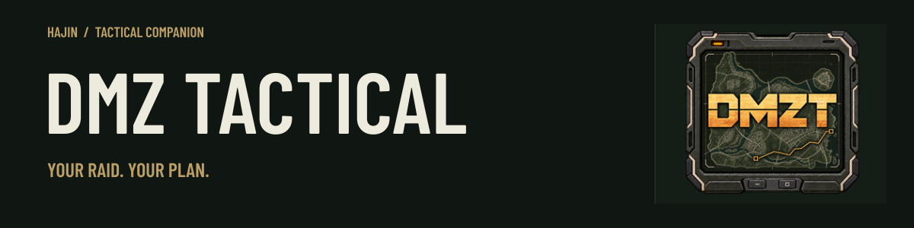
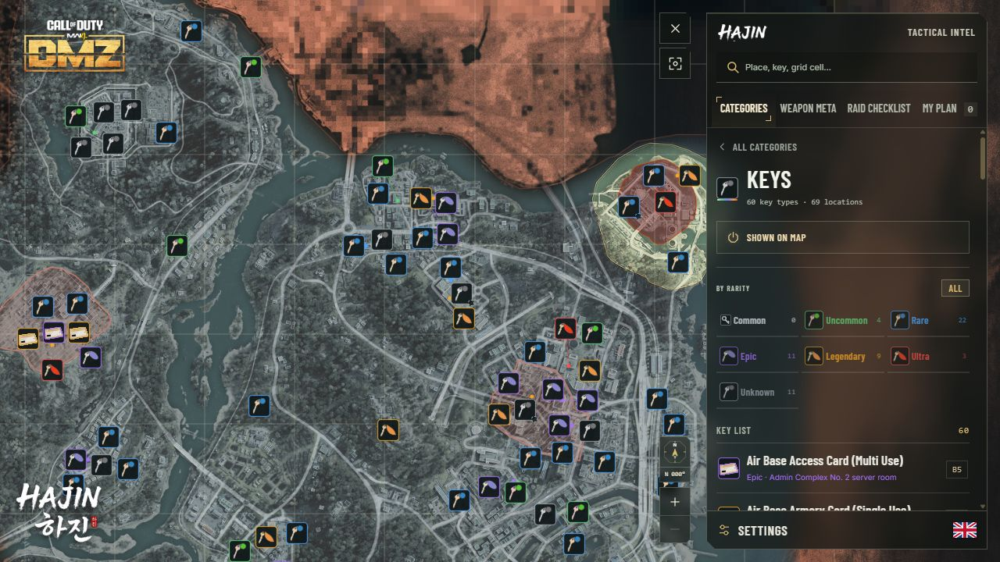
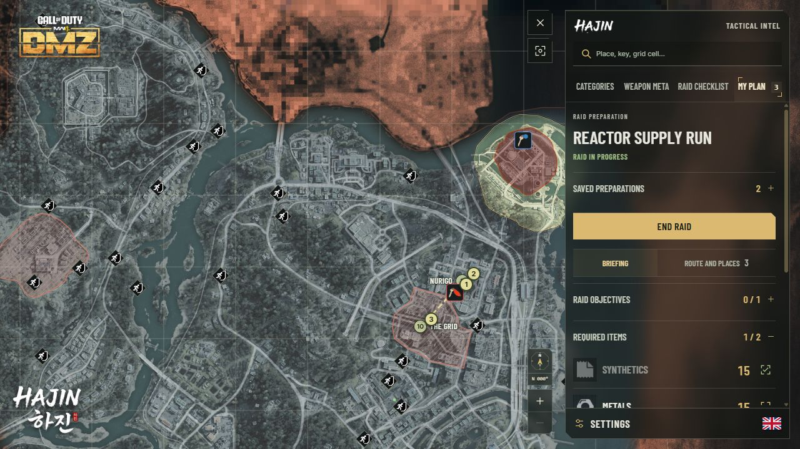
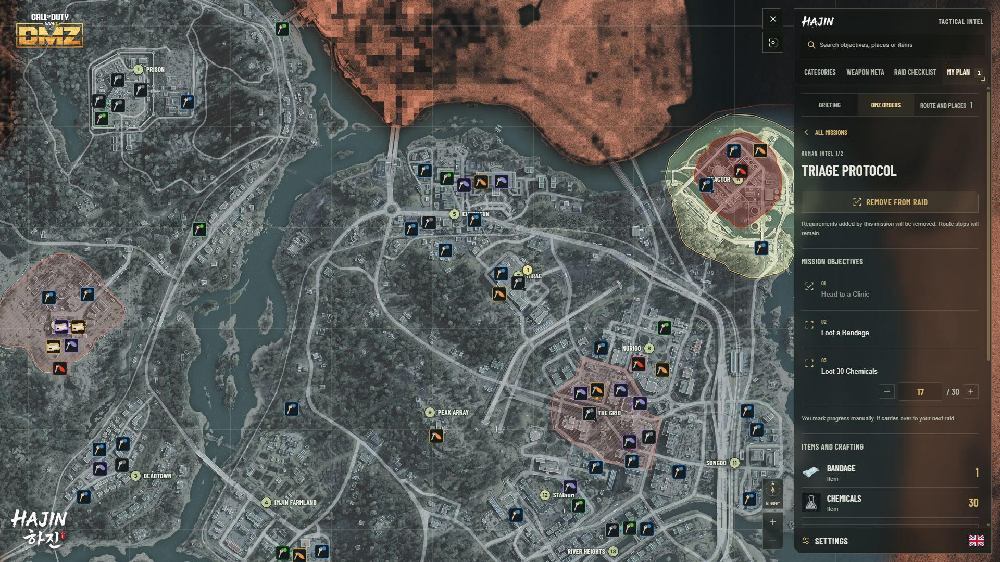
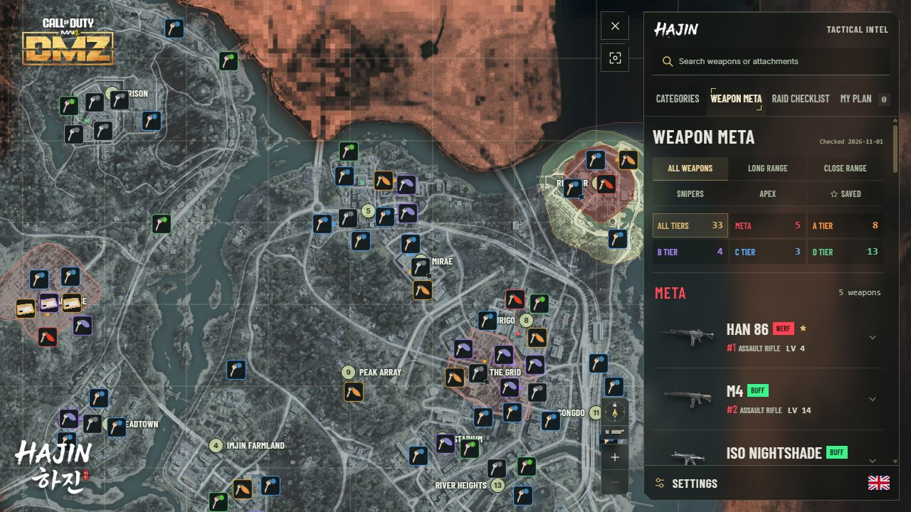
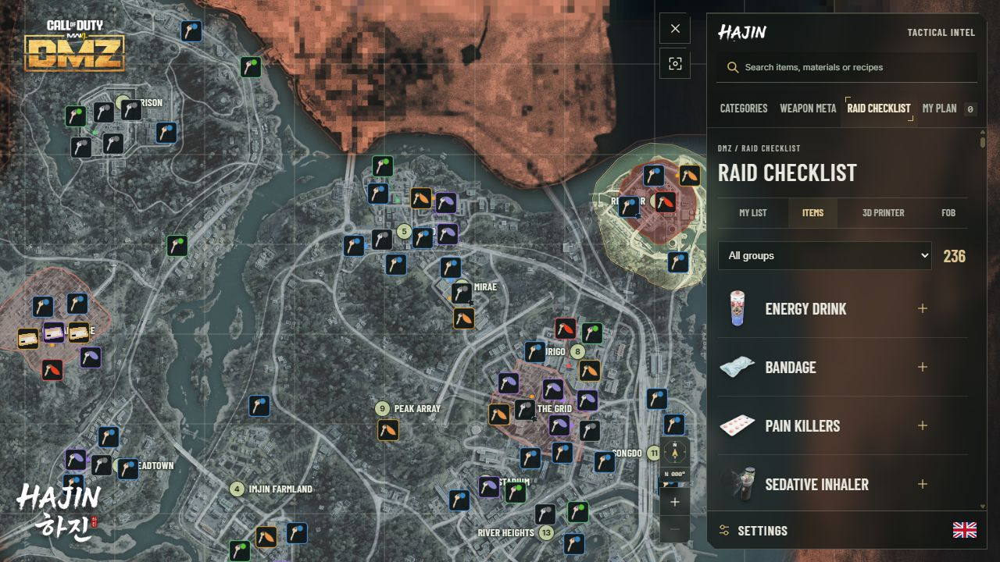
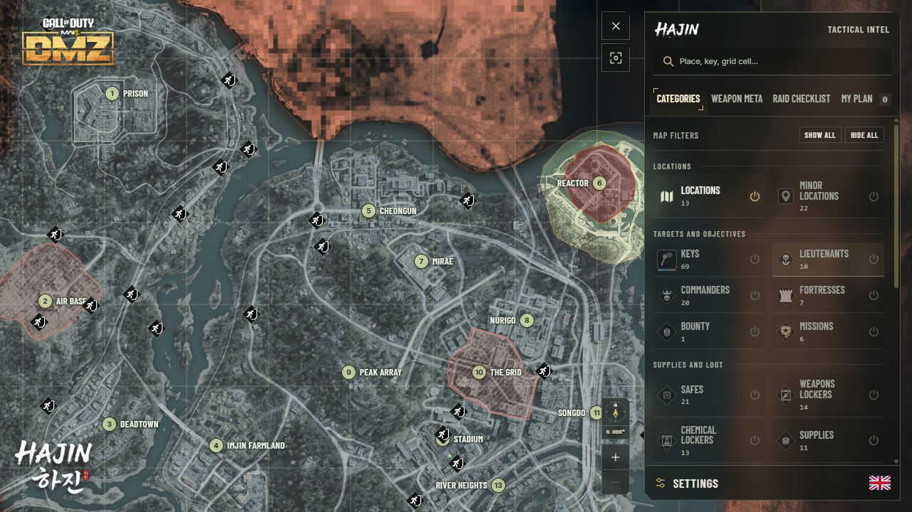
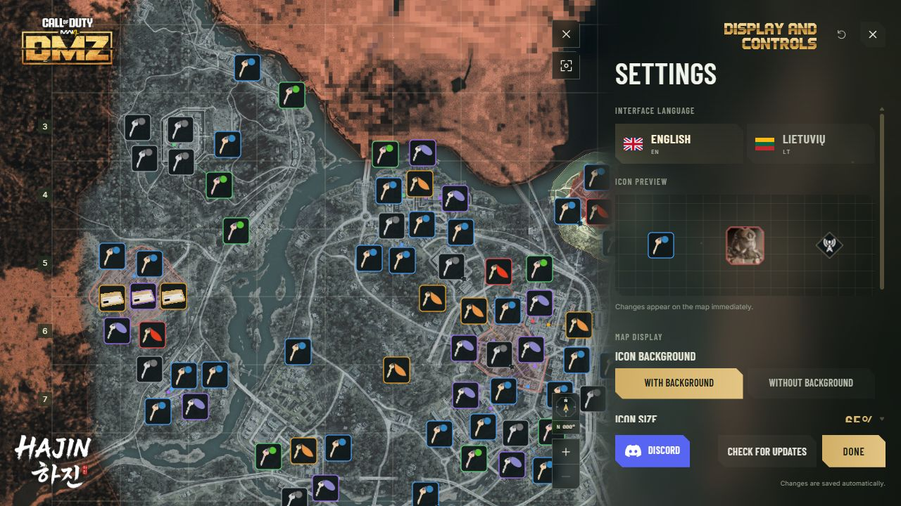

<strong>English</strong> &nbsp; | &nbsp; <a href="README.lt.md">Lietuvių</a>

Go into Hajin with your route already in mind. **DMZ Tactical** puts the map, key locations, weapon loadouts and a persistent loot list in one Windows app, ready for your next DMZ run.

 &nbsp; 

Windows x64 &nbsp; · &nbsp; English and Lithuanian &nbsp; · &nbsp; 1.5.60

## Know where you're heading

A key in your inventory should give you a destination. Browse keys by rarity, search by name or grid square, and focus the map on the location you need. Switch between commanders, safes, lockers, exfils and other categories as your priorities change.

**Keep the map useful.** Show the layers you need, rotate the view and adjust icon size, brightness and transparency to suit your screen. Keep icon backgrounds for contrast, or switch them off for a lighter view. Original commander and lieutenant portraits are retained in the new HAJIN frames.

## Prepare once. Stay focused during the raid.

Build a preparation in **My plan** with your objectives, keys to bring, route and weapon loadout. Keep separate plans for gathering materials, visiting locked locations or hunting commanders.

Start a raid to focus the map on your stops and key destinations, with possible exfils when you need them. Mark objectives, collected items and visited places as you go. Reopen the app to continue an unfinished raid, or start a new run with fresh progress and the same preparation.

Your saved preparations stay on your computer. Duplicate a preparation for another run or export your plans for backup.

## Every raid has an objective

Open **DMZ Orders** inside **My plan** to browse **72 Orders and 6 story missions**. Choose the missions for your next run, follow each step and keep partial progress, such as 17 of 30 materials, between raids.

See required items and rewards, add linked materials to your checklist and open mission areas on the map. Your tracked objectives also appear in the pinned raid window. You mark progress yourself; no game connection is needed.

## Your raid plan, always within reach

Open **Pinned raid window** from **My plan** to keep your objectives, required quantities and planned stops in a compact window beside your game. Mark progress as you go, or show only what remains. Changes appear in your main plan immediately.

Pin it above other apps, move it to a second monitor, resize it or collapse it to a small progress header. It stays visible when the main map is minimized and remembers its position, size and pin setting. Your keys and chosen loadout are one click away inside the window.

Available in English and Lithuanian. Shown here in Lithuanian.

Keep DMZ Tactical running while using the window. For visibility beside the game, use windowed or borderless mode, or a second monitor. Exclusive fullscreen games may cover it.

## Bring a loadout that fits the fight

Browse **Weapon Meta** from META through D Tier. Choose a weapon type and tier, or show only saved loadouts. Search and filters stay visible as you scroll. Open a weapon to review attachments, save its loadout or add it to **My plan**. All 33 ranked weapons have artwork, including launchers and the FSS Carbon Edge 1095.

## Know what to bring back

Use **Loot List** to track what you still need across raids. Add several items, 3D Printer crafts or FOB upgrade tiers. Shared material requirements are added together. Enter your owned quantities manually to see **Need / Have / Still need**, and expand a material to see which goals require it.

Browse **95 printer recipes** and **34 FOB upgrade tiers**. See what an upgrade gives you, what it unlocks and where to look for its materials. Your Loot List stays on your computer independently of raid plans. Starting a raid or removing a goal keeps your owned quantities. Update those amounts after using materials in game. Older checklists remain saved and can be copied as goals. No account, game connection or inventory access is required.

## Make it your operator

Save your full Activision ID in the DMZ Tactical Discord community with `/activisionid id:Callsign#1234567`, then sign in to the Windows app with the same Discord account. Your ID fills automatically when you create your **DMZT operator profile**.

Your activated ID is read-only in the app. To change it, use the Discord command, then sign in again to refresh it. Avatar, playstyle, region, communication language and microphone settings remain editable. Saving preferences or importing an older local profile preserves your activated ID.

Choose from **33 operator avatars, 17 regions and 84 communication languages**. An illustrated in-game guide helps you find and copy your Activision ID. Your map, plans and checklists still work without an account.

The gold **Continue with Discord** button signs you in. The blue **Discord** button beside it opens the community.

**Online player search in the Windows app is not available yet.** START remains disabled until online search is ready. Discord squad matchmaking remains available separately.

## Built to sit beside your game

A single **HAJIN interface** brings map categories, plans, loadouts, Settings and your operator into the same right-side workspace. Slimmer panels leave more room for Hajin, with a translucent surface that fades into the map. Choose English or Lithuanian, enlarge icons to suit your display and check them against the preview grid. The app remembers your window size and position, ready for next time.

## Ready for your next run?

1. Download **DMZTactical-Installer.exe** using the button above.
2. Approve the Windows administrator prompt and choose where to install. Setup creates a separate **DMZT** folder, then adds Desktop and Start Menu shortcuts.
3. Choose your language in Settings and start building your plan.

In **Settings**, select **Check for updates** beside **Done**. Your saved places, plans and preferences carry over.

<strong>Before you install</strong>

- **Current release:** 1.5.60. All 13 main Locations now use glowing 24 px gold badges with clipped corners, black numbers and orange DMZ stencil names without background panels. Keeps the 8K map, danger zones, HAJIN icons, X01 star and the navigation improvements from 1.5.55. Saved plans and progress remain intact. Online player search is not available yet.
- **Requirements:** Windows x64, administrator approval for installation; the complete map works offline. Internet is needed for downloads, account features and app updates. The installer downloads WebView2 when needed. A damaged or incomplete WebView2 installation may need repair before the app can start.
- **Coming from 1.0 or a Preview?** Uninstall the earlier per-user edition through Windows Settings before running the new installer. Your saved plans and preferences are kept.
- **Windows notice:** the installer is not code-signed. Windows may display Unknown Publisher or a SmartScreen warning.
- **Map data:** the bundled catalog is included. Catalog updates arrive with application releases. Spawn locations and community loadout recommendations can change with the game.
- **Download:** you only need **DMZTactical-Installer.exe**. The NUPKG file supports in-app updates. GitHub's Source code archives contain this download page, not an installer.

[Release details](https://github.com/DMZTactical/DMZT/releases/tag/v1.5.60)

Independent community companion. Not affiliated with or endorsed by Activision or Infinity Ward. Game names, map imagery and game artwork belong to their respective owners.
