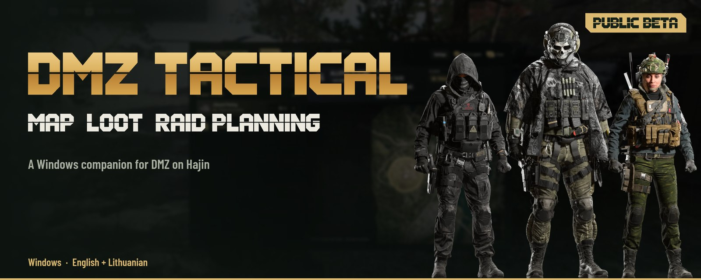
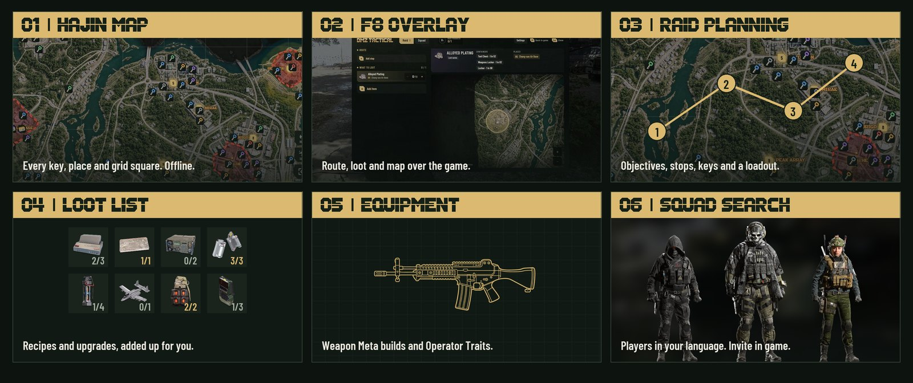
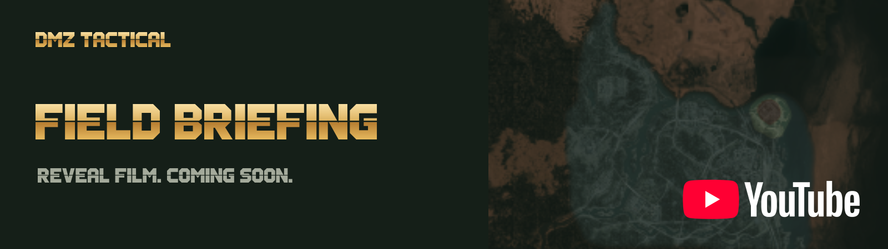
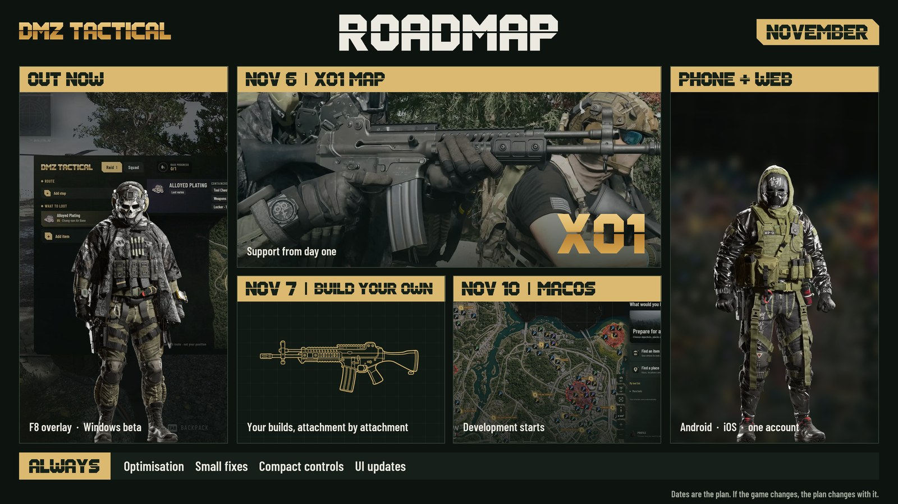
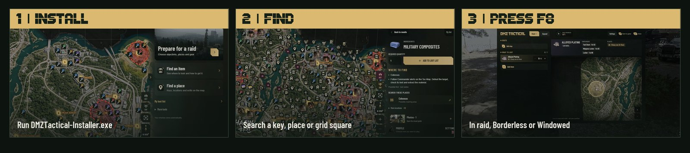

<picture>
<source media="(max-width: 600px)" srcset="media/hajin-hero-mobile-en.jpg">

</picture>

<strong>English</strong> · <a href="README.lt.md">Lietuvių</a>

 

## Your raid, in one place

Plan on **Hajin**. Press **F8** in raid. Works **offline, no account needed**.

<picture>
<source media="(max-width: 600px)" srcset="media/hajin-features-mobile-en.jpg">

</picture>

## What's next

<picture>
<source media="(max-width: 600px)" srcset="media/hajin-roadmap-mobile-en.jpg">

</picture>

Follow progress on <a href="https://discord.gg/PzCZNqmybB">Discord</a>.

## Start here

<picture>
<source media="(max-width: 600px)" srcset="media/hajin-steps-mobile-en.jpg">

</picture>

<strong>Already have the beta?</strong> Settings → <strong>Check for updates</strong>.

<strong>What's inside</strong>

- **Hajin map:** locations, keys, commanders and points of interest. Works offline.
- **Hot Zones:** estimated PvP risk. It does not track players.
- **Raid plans:** stops and DMZ Orders progress. Pin the raid window on a second monitor.
- **Loot lists:** items, recipes and upgrades, totals saved between raids.
- **Weapon Meta and Operator Traits:** builds and trait planning within your points.

<strong>Squad search and privacy</strong>

- Sign in with Discord, add your Activision ID and search in your language.
- Only players who are searching see each other. Stop, and you leave the list within 60 seconds.
- The ID format is checked, not account ownership.
- The game, its process and your inventory are never read.

<strong>Requirements</strong>

- Windows x64, administrator approval to install, Microsoft Edge WebView2.
- Internet for downloads, squad search and updates. Map and plans work offline.
- Exclusive fullscreen hides the overlay. Use Borderless or Windowed.
- The installer is not Authenticode signed, so Windows may show *Unknown Publisher*. Updates are checked against a signed manifest.
- You only need **DMZTactical-Installer.exe**. NUPKG files are for in-app updates.

Independent community companion. Not affiliated with or endorsed by Activision or Infinity Ward. Game names, map imagery and game artwork belong to their respective owners.
