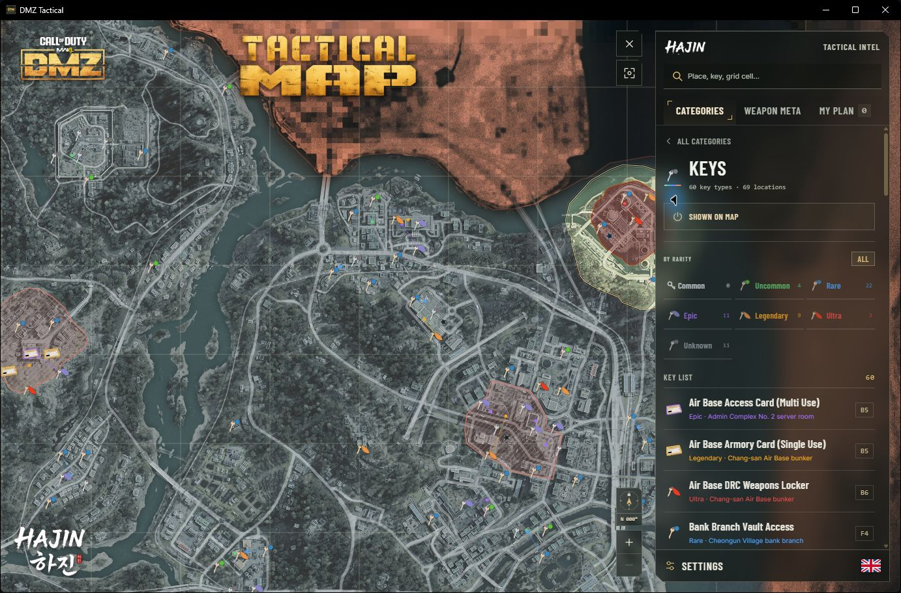
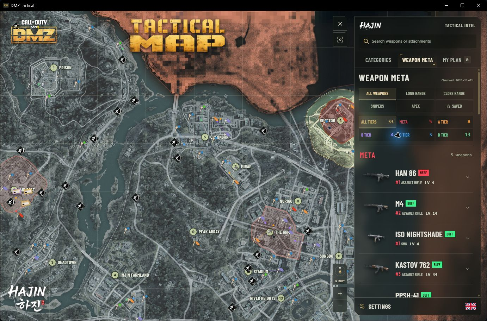
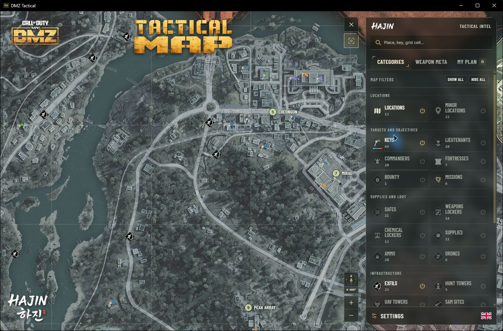

<strong>English</strong> &nbsp; | &nbsp; <a href="README.lt.md">Lietuvių</a>

Go into Hajin with your route already in mind. **DMZ Tactical** puts the map, key locations and weapon loadouts in one Windows app, ready for your next DMZ run.

Windows x64 &nbsp; · &nbsp; English and Lithuanian &nbsp; · &nbsp; 1.0 Preview

## Know where you're heading

A key in your inventory should give you a destination. Browse keys by rarity, search by name or grid square, and focus the map on the location you need. Switch between commanders, safes, lockers, exfils and other categories as your priorities change.

**Keep the map useful.** Show the layers you need, rotate the view and adjust icon size, brightness and transparency to suit your screen.

## Turn your targets into a plan

Add stops to **My Plan**, put them in order and mark places as visited. Save useful locations and add your own markers for the next run. Your plan stays on your computer, with import and export when you want to take it with you.

## Bring a loadout that fits the fight

Browse **Weapon Meta** from META through D Tier. Compare long-range and close-range options, open a build to see its attachments, then save the loadout or copy the attachment list. It all sits beside the map, so you can prepare without losing your place.

## Built to sit beside your game

A dark tactical interface, familiar rarity colours and a transparent side panel keep the focus on Hajin. Choose English or Lithuanian in Settings. Move from planning a route to checking a key or picking a build in the same workspace.

## Ready for your next run?

1. Download **DMZTactical-Installer.exe** using the button above.
2. Run the installer and open **DMZ Tactical**.
3. Choose your language in Settings and start building your plan.

Updates are available inside **Settings**, under **Application updates**. Your saved places, plans and preferences carry over.

<strong>Before you install</strong>

- **Current release:** 1.0.0-preview.4. This is a preview; testing for the stable 1.0 release is still in progress.
- **Requirements:** Windows x64 and an internet connection for map imagery. The installer handles WebView2 when needed.
- **Windows notice:** the installer is not code-signed. Windows may display Unknown Publisher or a SmartScreen warning.
- **Map data:** the bundled catalog is included. Public live-data synchronization is not available in this preview. Spawn locations and community loadout recommendations can change with the game.
- **Download:** you only need **DMZTactical-Installer.exe**. The other release files support the updater or file verification. GitHub's Source code archives contain this download page, not an installer.

[Release details and file checksums](https://github.com/Liftoop/DMZT/releases/tag/v1.0.0-preview.5)

Independent community companion. Not affiliated with or endorsed by Activision or Infinity Ward. Game names, map imagery and game artwork belong to their respective owners.
