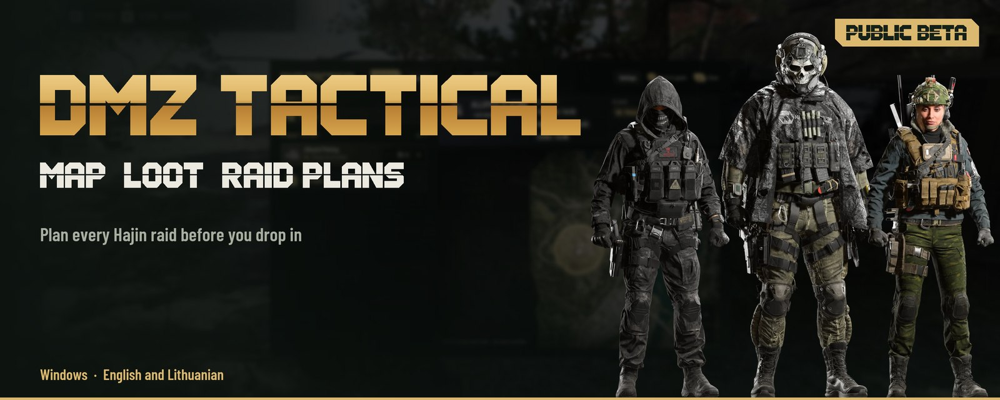
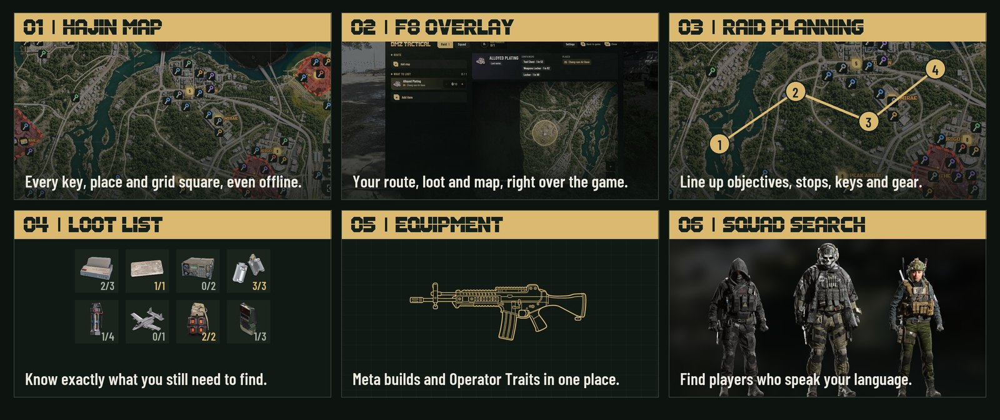
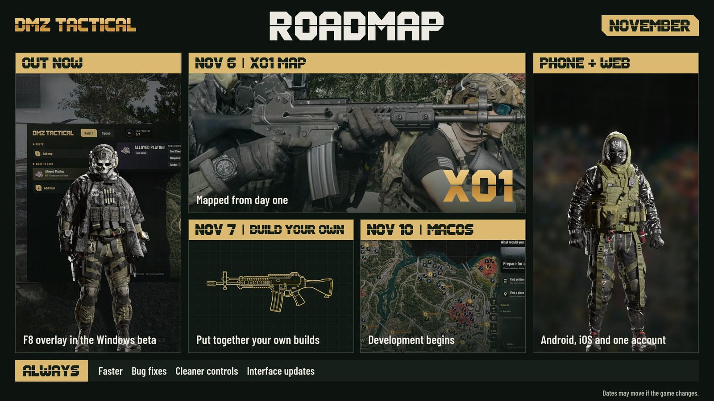
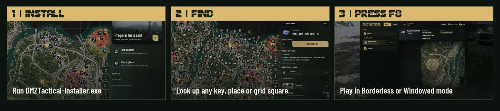

<picture>
<source media="(max-width: 600px)" srcset="media/hajin-r3-hero-mobile-en.jpg">

</picture>

<strong>English</strong> · <a href="README.lt.md">Lietuvių</a>

 

 

## Your raid, in one place

Plan your raid on **Hajin**, then press **F8** in game. Works **offline**, no account needed.

<picture>
<source media="(max-width: 600px)" srcset="media/hajin-r3-features-mobile-en.jpg">

</picture>

## What's next

<picture>
<source media="(max-width: 600px)" srcset="media/hajin-r3-roadmap-mobile-en.jpg">

</picture>

Follow progress on <a href="https://discord.gg/PzCZNqmybB">Discord</a>.

## Start here

<picture>
<source media="(max-width: 600px)" srcset="media/hajin-r3-steps-mobile-en.jpg">

</picture>

<strong>Already have the beta?</strong> Settings → <strong>Check for updates</strong>.

## FAQ

<picture>
<source media="(max-width: 600px)" srcset="media/hajin-r3-faq-mobile-en.jpg">

</picture>

<picture>
<source media="(max-width: 600px)" srcset="media/hajin-r3-details-mobile-en.jpg">

</picture>

Independent community companion. Not affiliated with or endorsed by Activision or Infinity Ward. Game names, map imagery and game artwork belong to their respective owners.
