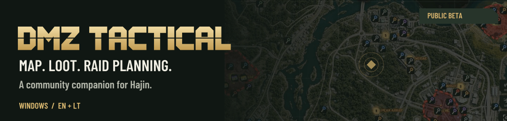
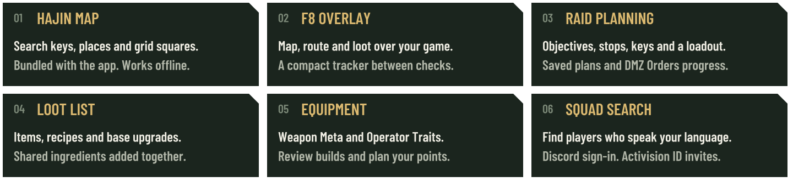
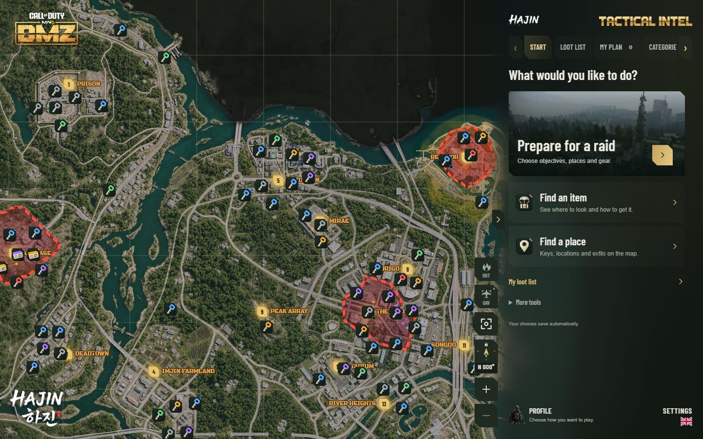
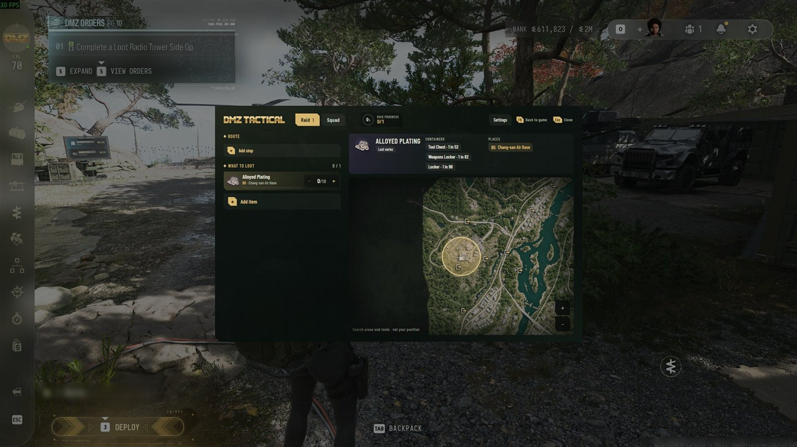
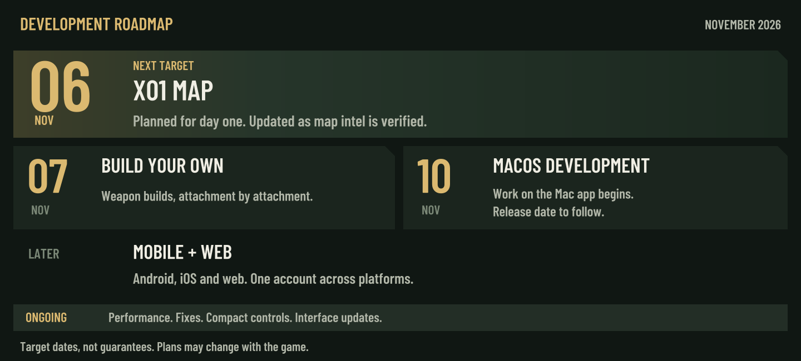

<picture>
<source media="(max-width: 600px)" srcset="media/hajin-hero-mobile-en.svg">
<source media="(prefers-reduced-motion: reduce)" srcset="media/hajin-hero-en.svg">

</picture>

<strong>English</strong> · <a href="README.lt.md">Lietuvių</a>

## Your raid, in one place

Find what you need on **Hajin**, prepare a route and carry your plan into the raid with **F8**. The map, loot list and raid planning work **offline, without an account**. Squad search uses Discord.

<picture>
<source media="(max-width: 600px)" srcset="media/hajin-features-mobile-en.svg">

</picture>

<table>
<tr><td width="50%"></td><td width="50%"></td></tr>
<tr><td align="center">Explore Hajin</td><td align="center">Keep the plan in view with F8</td></tr>
</table>

<a href="https://www.youtube.com/watch?v=TBih6NpHspg">Watch the beta in action</a>

## What's next

<picture>
<source media="(max-width: 600px)" srcset="media/hajin-roadmap-mobile-en.svg">

</picture>

The **Build your own** editor is currently hidden; saved custom loadouts are kept. Windows is available now. **macOS, mobile and web are planned work.** Follow progress and share feedback on [Discord](https://discord.gg/PzCZNqmybB).

## Start here

1. Download **DMZTactical-Installer.exe**, close the app if it is running and follow Windows Setup.
2. Choose **English** or **Lithuanian** in **Settings**, then search for a key, place or grid square.
3. Build a plan. During a raid, press **F8** over a **Borderless** or **Windowed** game.

**Already have the beta?** Open **Settings** and choose **Check for updates**.

If the app opens but the map stays blank, Windows is missing Microsoft WebView2.

<strong>Map, loot and equipment</strong>

The bundled **Hajin map** includes searchable locations, keys, commanders and points of interest. Add stops to a saved plan; **DMZ Orders** keeps mission steps and partial progress. A pinned raid window can sit on a second monitor, with changes carried back to the main plan.

**Loot lists** combine items, recipes and base upgrades. Shared ingredients are totalled, quantities stay saved between raids, and item entries link to acquisition advice, locations and available reference photos. Your in-game inventory is never read.

**Weapon Meta** brings rankings and attachment recommendations together. **Operator Traits** covers Warfighter, Scout and Survivalist; plan within your earned points and keep Minor examples separate from traits you actually received. Recommendations can change with game updates.

**Hot Zones** estimates PvP risk; it does not track players or active exfils. **UAV** is an optional camera orbit around a selected map marker. Both can be switched off.

<strong>Squad search and privacy</strong>

Sign in with **Discord**, enter your **Activision ID** and search in your language. Review each player's operator, callsign and playstyle, then copy their ID to invite them in the game. You can also set your ID with `/activisionid` in our Discord server.

Only people who are actively searching can see other searchers. Stop searching, close the window or change the language, and you leave the list within **60 seconds**. The ID format is checked; Activision account ownership is not verified.

DMZ Tactical does not read the game process, track live player positions or change in-game traits.

<strong>Windows requirements and installation help</strong>

- **Windows x64**, with administrator approval for installation.
- **Microsoft Edge WebView2**. Setup tries to install it if it is missing. If the app opens but the map stays blank, [install WebView2](https://developer.microsoft.com/microsoft-edge/webview2/#download).
- Internet is needed for downloads, squad search and updates. Map browsing, loot lists and raid planning work offline.
- Exclusive fullscreen may cover the overlay or pinned raid window. Use Borderless, Windowed or a second monitor.
- The installer is not Authenticode signed; Windows may show **Unknown Publisher**. In-app updates are checked against the signed manifest and file hashes.
- A fresh install needs only **DMZTactical-Installer.exe**. NUPKG files are for in-app updates. GitHub's **Source code** archives contain this download page, not the private application source.

Independent community companion. Not affiliated with or endorsed by Activision or Infinity Ward. Game names, map imagery and game artwork belong to their respective owners.
