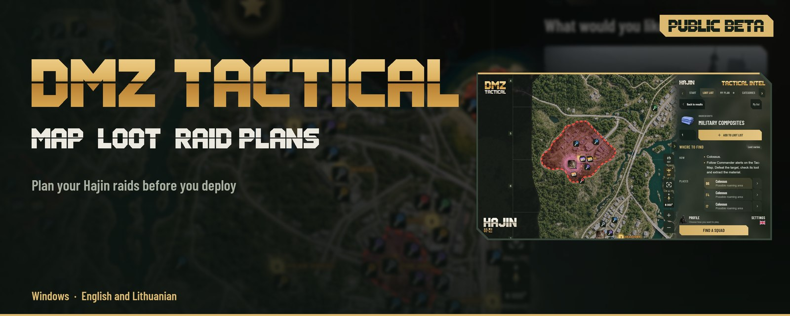
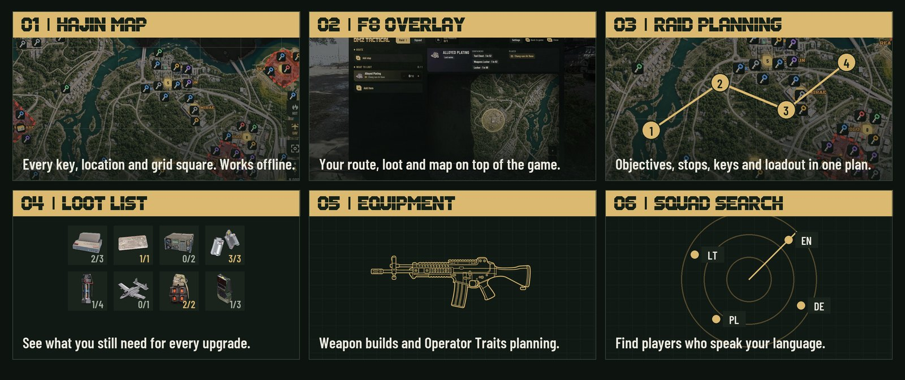
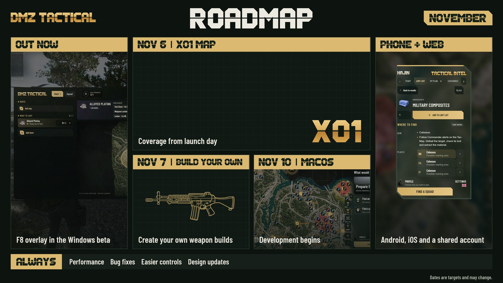
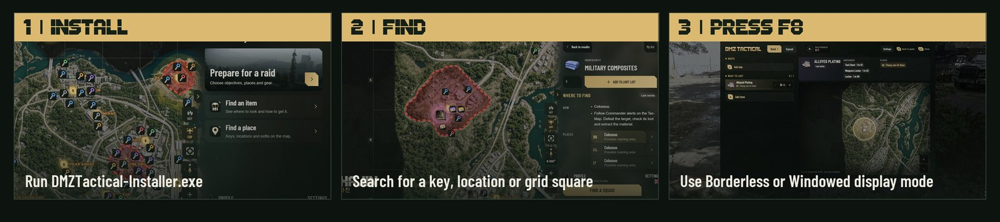

<picture>
<source media="(max-width: 600px)" srcset="media/hajin-r5-hero-mobile-en.jpg">

</picture>

<strong>English</strong> · <a href="README.lt.md">Lietuvių</a>

 

 

## Your raid, in one place

Plan your raid on **Hajin**, then open it in game with **F8**. Works offline, no account required.

<picture>
<source media="(max-width: 600px)" srcset="media/hajin-r5-features-mobile-en.jpg">

</picture>

## What's next

<picture>
<source media="(max-width: 600px)" srcset="media/hajin-r5-roadmap-mobile-en.jpg">

</picture>

Follow progress on <a href="https://discord.gg/PzCZNqmybB">Discord</a>.

## Start here

<picture>
<source media="(max-width: 600px)" srcset="media/hajin-r5-steps-mobile-en.jpg">

</picture>

<strong>Already using the beta?</strong> Go to Settings → <strong>Check for updates</strong>.

## FAQ

<picture>
<source media="(max-width: 600px)" srcset="media/hajin-r5-faq-mobile-en.jpg">

</picture>

<picture>
<source media="(max-width: 600px)" srcset="media/hajin-r5-details-mobile-en.jpg">

</picture>

© 2026 DMZ Tactical. A fan-made companion app, not affiliated with, endorsed by, or sponsored by Activision Publishing, Inc. or Infinity Ward. Call of Duty® and related marks are trademarks of Activision Publishing, Inc. All game content and imagery belong to their respective owners. <a href="PRIVACY.md">Privacy policy</a>

