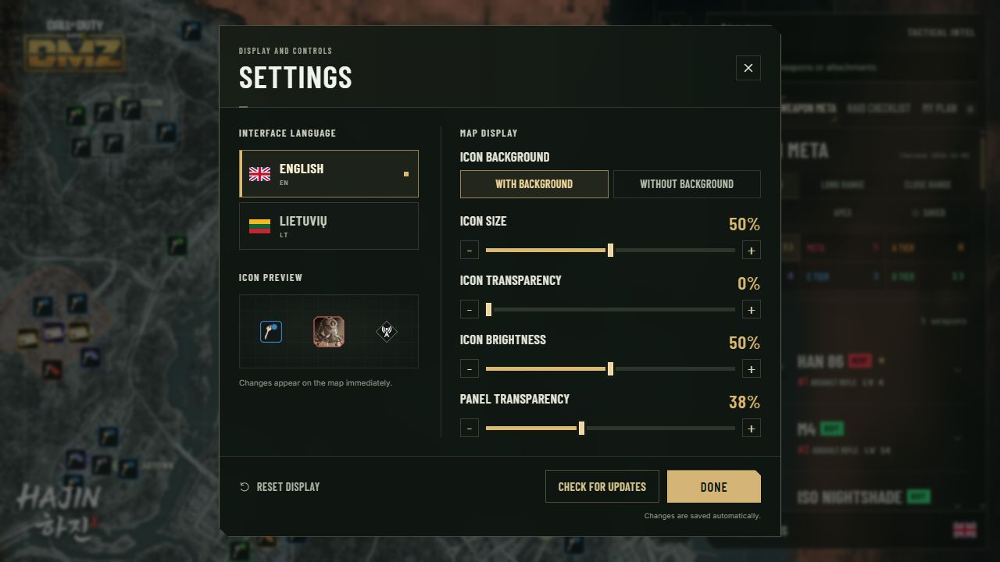

<strong>English</strong> &nbsp; | &nbsp; <a href="README.lt.md">Lietuvių</a>

Go into Hajin with your route already in mind. **DMZ Tactical** puts the map, key locations, weapon loadouts and raid checklist in one Windows app, ready for your next DMZ run.

Windows x64 &nbsp; · &nbsp; English and Lithuanian &nbsp; · &nbsp; 1.0.4

## Know where you're heading

A key in your inventory should give you a destination. Browse keys by rarity, search by name or grid square, and focus the map on the location you need. Switch between commanders, safes, lockers, exfils and other categories as your priorities change.

**Keep the map useful.** Show the layers you need, rotate the view and adjust icon size, brightness and transparency to suit your screen. Keep icon backgrounds for contrast, or switch them off for a lighter view. Commander and lieutenant portraits stay unchanged.

## Turn your targets into a plan

Add stops to **My Plan**, put them in order and mark places as visited. Save useful locations and add your own markers for the next run. Your plan stays on your computer, with import and export when you want to take it with you.

## Bring a loadout that fits the fight

Browse **Weapon Meta** from META through D Tier. Compare long-range and close-range options, open a build to see its attachments, then save the loadout or copy the attachment list. It all sits beside the map, so you can prepare without losing your place.

## Know what to bring back

Build a **Raid Checklist** before you deploy. Choose the items you need or select a 3D Printer recipe, then keep the required materials in one place. Shared ingredients are added together, and you can mark each item collected during your run.

Browse **95 printer recipes** and **34 FOB upgrade tiers**. See what an upgrade gives you, what it unlocks and where to look for its materials. Your checklist stays on your computer. No account, game connection or inventory access is required.

## Built to sit beside your game

A dark tactical interface, familiar rarity colours and a transparent side panel keep the focus on Hajin. Choose English or Lithuanian in Settings. Move from planning a route to checking a key or picking a build in the same workspace. The app remembers your window size and position, ready for next time.

## Ready for your next run?

1. Download **DMZTactical-Installer.exe** using the button above.
2. Approve the Windows administrator prompt and choose where to install. Setup creates a separate **DMZT** folder, then adds Desktop and Start Menu shortcuts.
3. Choose your language in Settings and start building your plan.

In **Settings**, select **Check for updates** beside **Done**. Your saved places, plans and preferences carry over.

<strong>Before you install</strong>

- **Current release:** 1.0.4. Choose icons with or without backgrounds, with cleaner Settings and English first in the language selector. No account is required.
- **Requirements:** Windows x64, administrator approval for installation and internet for map imagery. The installer downloads WebView2 when needed.
- **Coming from 1.0 or a Preview?** Uninstall the earlier per-user edition through Windows Settings before running the new installer. Your saved plans and preferences are kept.
- **Windows notice:** the installer is not code-signed. Windows may display Unknown Publisher or a SmartScreen warning.
- **Map data:** the bundled catalog is included. Catalog updates arrive with application releases. Spawn locations and community loadout recommendations can change with the game.
- **Download:** you only need **DMZTactical-Installer.exe**. The NUPKG file supports in-app updates. GitHub's Source code archives contain this download page, not an installer.

[Release details](https://github.com/DMZTactical/DMZT/releases/tag/v1.0.4)

Independent community companion. Not affiliated with or endorsed by Activision or Infinity Ward. Game names, map imagery and game artwork belong to their respective owners.
